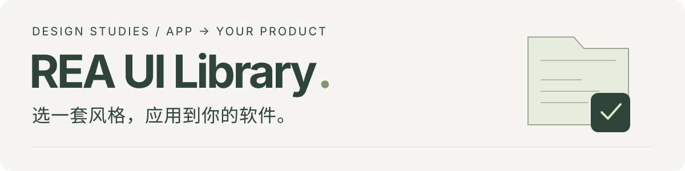
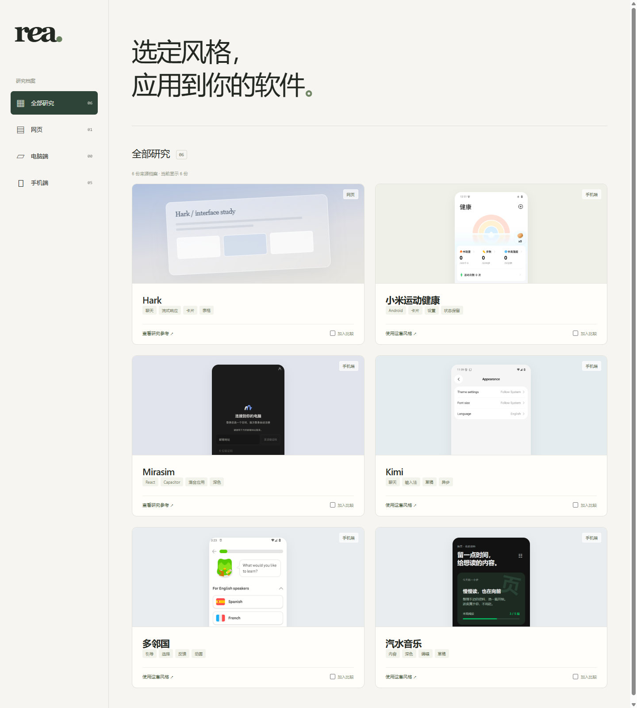
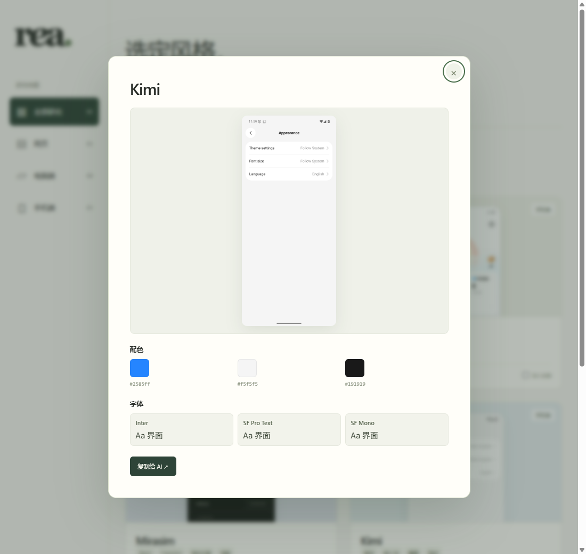
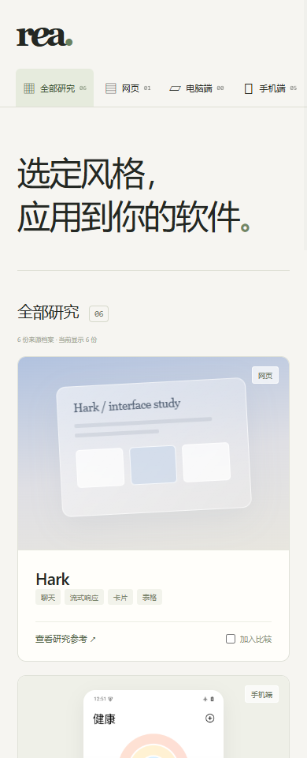

<p align="center">
  
</p>

<p align="center">
  <strong>让 AI 带着设计规范改界面：排版、组件、动画，以及用户操作后的反馈。</strong><br>
  保留你的业务、数据、品牌和技术栈。
</p>

<p align="center">
  <a href="https://ecdison6227.github.io/rea-ui-library/"><strong>打开在线风格库 ↗</strong></a>　·　
  <a href="#选一套风格">浏览设计包</a>　·　
  <a href="#让-ai-开始实施">复制 AI 指令</a>　·　
  <a href="#本地使用">本地使用</a>
</p>

<a href="https://ecdison6227.github.io/rea-ui-library/">
  
</a>

<p align="center"><sub>在线目录实际截图 · 点击进入 GitHub Pages · 选中卡片可查看配色、字体与设计入口</sub></p>

## 从喜欢的 App，到自己的产品

功能已经做好，界面还缺一套连贯的设计？在这里选一个来源，让 AI 读取它的设计包，再实际修改你的项目。它拿到的不只是截图，还有文字与几何参数、组件状态、布局、动效、返回与保存取消等规则，以及来源依据和对照。

1. **选风格。** 在[在线目录](https://ecdison6227.github.io/rea-ui-library/)浏览，打开卡片查看画面、配色和字体。
2. **取规范。** 复制迁移任务，填写项目路径；AI先读来源规范，再检查你现有的代码。
3. **做进产品。** 完成代表页面及正常、空、加载、错误、取消等状态，运行验证并交付前后对照。

<p align="center">
  
  
</p>

## 选一套风格

| 来源 | 适合借鉴 | 入口 |
| --- | --- | --- |
| **多邻国** | 有厚度的按钮、选择反馈、分步引导、进度与轻快动效 | [设计包](platforms/mobile/duolingo-android-6-80-6-china-2368/README.md) |
| **小米运动健康** | 概览卡片、分组设置、层级留白、导航与受控开关 | [设计包](platforms/mobile/mi-fitness/README.md) |
| **Kimi** | 多行输入、草稿、对话反馈、保存取消、异步与重试 | [设计包](platforms/mobile/kimi/README.md) |
| **Kimi Web** | 暖白工作区、浮动输入、项目辅助卡、富文本与可搜索目录 | [设计包](platforms/web/kimi-web/README.md) |
| **汽水音乐** | 深色表面、薄荷色决策层、主次动作、编辑与失败重试 | [设计包](platforms/mobile/qishui-music-android-21-1-0/README.md) |
| **Muse** | 居中品牌首屏、头像与短句动效、圆角输入、交替图文与响应式 | [设计包](platforms/web/muse-public-home/README.md) |
| **Hark Android** | 原生导航、锚定菜单、输入与卡片宿主；另附Web元素的手机适配参考 | [设计包](platforms/mobile/hark-android/README.md) |
| **Hark Web** | 玻璃材质、流式内容、富内容卡片与天空背景 | [研究参考](platforms/web/hark/README.md) |
| **Mirasim** | 简洁分组、深浅主题、抽屉与混合应用边界 | [研究参考](platforms/mobile/mirasim/README.md) |

多邻国、小米、Kimi（Android）、Kimi Web、汽水音乐、Muse和Hark Android为 **Design Package v1**，Hark Web、Mirasim保留历史研究入口。各包的 `partial` 表示仍有原版未知参数或还原差异；使用范围和目标实现选择写在包内。Hark Android已深化原生静态结构，核心运行受Play地区/授权条件限制；新增的Web手机适配与目录封面均是明确D参考。Kimi Web的ready只适用于声明的代表UI；Muse的ready限定公开首页，未登录，保留长视频和跨设备的未测边界。原版全部业务不因此变为已测。汽水音乐的目录封面是独立 Web 参考，其检查结果不替代原版 Android 验证。

## 让 AI 开始实施

把下面这段交给你的编码 Agent，替换 App 和项目路径：

```text
我的软件功能和基础界面已经完成。请读取
https://github.com/ECdison6227/rea-ui-library
把【多邻国 / 小米运动健康 / Kimi / Kimi Web / 汽水音乐 / Muse】的视觉、动画和通用交互
应用到我的项目：【项目路径】。

先读仓库 AGENTS.md 和选定来源的 design-package.json、DESIGN_SPEC.md、
ADAPTATION_GUIDE.md，再按需读取 tokens、组件、布局、交互、动效与对照。
记录实际使用的 commit，沿用我的技术栈、业务、数据、品牌和接口。
可用的字体、图表、组件、图标和布局优先直接复用；按目标UI逻辑轻量增删功能、调整文案，记录理由并保持核心任务和数据路径可用。

实际修改代码，完成代表页面和返回、输入、草稿、保存取消、加载、错误、重试等状态。
来源未知参数使用包内明确标为 D 的适配方案，保留差异记录。
运行页面和交互，交付前后对照与验证结果。
```

已安装技能可使用 `$rea-design-transfer 应用规范模式`；也可直接读取[随库技能](skills/rea-design-transfer/SKILL.md)。[完整实施约定](docs/apply-a-style.md)说明接手与验收要求。

## 设计包里有什么

| 模块 | 用途 |
| --- | --- |
| `design-package.json` / `DESIGN_SPEC.md` | 来源、版本、范围与整体视觉规则 |
| Tokens / Components / Layouts | 文字、表面、间距、形状、组件状态和页面组合 |
| Interactions / Motion | 用户操作、状态变化、时序、曲线、中断与减少动画 |
| Assets / Evidence / Reference / Comparison | 找素材、查依据、运行参考、核对具体差异 |
| `ADAPTATION_GUIDE.md` | 把来源关系映射到自己的产品 |

证据按 **A 原版观察 / B 静态声明 / C 推断 / D 独立实现** 区分。来源研究、参考演示、你自己的产品验收各自记录；截图和格式校验不会自动变成运行通过。

## 本地使用

需要 **Node.js 22.13+** 和 Git，目录无第三方运行依赖。

```sh
git -c core.longpaths=true clone https://github.com/ECdison6227/rea-ui-library.git
cd rea-ui-library
npm run sources:init
npm run dev
```

打开 **http://127.0.0.1:4318/**。只想选型可直接用 [GitHub Pages](https://ecdison6227.github.io/rea-ui-library/)，无需安装。

<details>
<summary><strong>只拉取一套风格，减少下载</strong></summary>

以小米运动健康为例：

```sh
git -c core.longpaths=true clone --filter=blob:none --sparse https://github.com/ECdison6227/rea-ui-library.git
cd rea-ui-library
git config --local core.longpaths true
git sparse-checkout set platforms/mobile/mi-fitness skills/rea-design-transfer docs
git rev-parse HEAD
```

其他目录见上方设计包链接。保留 dp/sp、CSS px 和物理像素的区别，跨平台转换按目标项目验证。

</details>

## 维护与发布

新来源按[入库标准](docs/adding-studies.md)提交可实施的规范、证据和文件锁。推送 `main` 后，[GitHub Actions](https://github.com/ECdison6227/rea-ui-library/actions/workflows/pages.yml)自动测试、构建并更新 Pages；已打开的目录会定期检查更新。

```sh
npm test
npm run build
npm run verify
```

Pages 只发布目录、说明和已审缩略图。研究仓库公开，新增资料仍须检查私人画面、凭据和设备数据；原包与品牌资产的留存不授予下游再分发许可。

[Pages 发布与排查](docs/pages.md) · [设计包格式](skills/rea-design-transfer/references/design-package.md) · [架构](docs/architecture.md) · [历史来源](docs/migrations/2026-10-19/imports.json)
