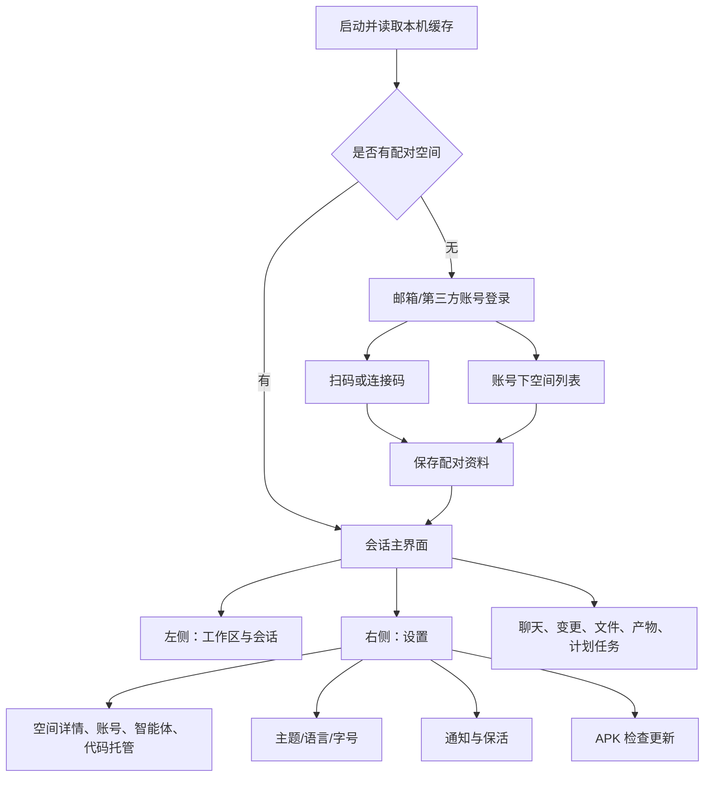

# UI 设计拆解

## 设计方向

这是高频使用的远程工作工具。首屏围绕“连接电脑/进入会话”，已连接后主角是会话内容与输入框。整体视觉克制：低饱和背景、分组列表、细边框、小面积强调色、清晰的字号层级。保留这套层级和交互节奏，比仅复制 Logo 或某个色号更能保留观感。

本次没有重新设计原软件，没有替换原始文案、资产或组件；截图展示 APK 原前端。设计研究未做额外的独立视觉评分。

## 色彩系统：实际值

| 语义 | 变量 | 浅色 | 深色 |
| --- | --- | --- | --- |
| 最底背景 | `--surface-0` | `#fff` | `#1b1b1b` |
| 次级面 | `--surface-1` | `#f7f7f8` | `#212121` |
| 卡片面 | `--surface-2` | `#fff` | `#262626` |
| 更高一层 | `--surface-3` | `#ececef` | `#303030` |
| 浮层面 | `--surface-elev` | `#fff` | `#393939` |
| 主文字 | `--th-fg` | `#000000d2` | `#ecebe7` |
| 辅助文字 | `--th-fg-5` | `#4a4a53c7` | `#e5e4dbcc` |
| 细边框 | `--edge-subtle` | `#18181b1a` | `#faf9f51a` |
| 品牌操作色 | `--brand-cta` | `#7c64c4` | `#cccaff` |
| 品牌图形强调 | `--brand-mark-accent` | `#2a58c0` | `#7499f2` |
| 暖色强调 | `--accent` | 支持时使用 `oklch(55% .12 55)` | `#d97757` |

依据 `app.css:17695` 起的基础变量与 `app.css:17933` 起的暗色覆盖。真实生效的移动端 `--m-floor` 浅色使用颜色混合，**不等于纯白**；深色才直接等于 `--surface-0`。浅色设置截图出现浅灰页面、白卡片，正由此形成。

完整结果有 154 个非空变量/主题，保存在 [浅色 JSON](../reference/design-tokens-light.json)、[深色 JSON](../reference/design-tokens-dark.json) 和 [合并 CSS](../reference/design-tokens.css)。这是在 393×852 Chromium 视口下读取的计算值，含 CSS 变量展开结果；不是手工猜的调色板。

## 字体与密度

| 移动端样式 | 字号 | 行高 | 用途 |
| --- | --- | --- | --- |
| `m-title` | 22px | 1.2 | 页面标题 |
| `m-headline` | 16px | 1.35 | 设置项标题、行主文案 |
| `m-body` | 15px | 1.45 | 正文与说明 |
| `m-sub` | 13px | 1.45 | 次级说明 |
| `m-caption` | 12px | 1.3 | 分组标签，字距 .06em |
| `m-mono` | 12px | 1.35 | 版本号、数字与技术信息 |

字体栈由 `Mirasim CJK`、系统字体和 `SF Pro Text` 等组成；等宽栈先尝试 `JetBrains Mono`。定义字体名称不代表 APK 包含对应字体文件；内置大量 KaTeX 字体是数学渲染资源。设备字体会让实际中文形态和字宽变化。

桌面共享层另有 11/12/13/14/16px 的密度变量，**手机 UI 应使用 `--m-text-*`**。设置中有标准/较大字号和跟随系统/浅色/深色选项。依据 `app.css:18814`、`app.css:18900`，主题状态依据 `app.js:15163`。

## 组件规则

| 组件 | 已提取规则 | 依据 |
| --- | --- | --- |
| 分组卡片 `m-group` | 12px 圆角，1px 低对比边框，裁剪内部行；浅色轻阴影，深色去阴影 | `app.css:19014` |
| 设置行 `m-row` | 相邻行 1px 分隔；默认从左 14px 起；带图标从 58px 起，带头像从 66px 起 | `app.css:19023` |
| 触控区 | 多个按钮保证至少 44×44px，视觉图标可更小 | `app.css:19000`；`app.js:204526` |
| 分段选择 `m-seg` | 外轨道 9px 圆角、2px 内距；滑块 7px 圆角；选项至少 30px 高 | `app.css:19063` |
| 左抽屉 | `min(100vw - 48px, 360px)`，保留一条可见主页面边缘 | `app.css:18824` |
| 右侧设置 | 宽 `min(100vw, 420px)`、固定右侧，窄屏几乎全屏，独立层级与滚动 | `app.css:19167` |
| 输入区域 | 页面底部浮置圆角容器，顶部工具行和正文输入分层，附件/发送两侧对齐 | [主界面截图](../preview/home-offline/page.png) |
| 图标 | 构建产物内联 SVG，常见 `currentColor`、圆角端点；不是所有图标都来自图片文件 | `app.js:201768` 等 |

## 页面与导航

主壳层的可导航目标在 `app.js:192865`，连接后的面板组织在 `app.js:215179` 起。设置内部是局部 `root/host/agent/thinking/account/git/calls/me` 状态，使用 `onInnerViewChange` 和 `popInnerRef` 协调返回，而非每个面板都重新开一个 Android Activity。

静态前端还含成员与邀请、空间切换、用量、账单、文件分享、Markdown/KaTeX/Mermaid、代码高亮、PDF 预览等能力。各自存在的代码不意味着未登录状态下可访问或所有服务器都支持。

## 动效与手势

| 动作 | 观察到的实现 |
| --- | --- |
| 基础时长 | 100/160/240/320ms 四档；`cubic-bezier(.21,.47,.32,.98)` 为主要出场曲线 |
| 面板开合 | 打开通常 240ms；后续覆盖关闭为 `240ms × .7 = 168ms`，遮罩配套变透明 |
| 设置分段 | 滑块 `transform` 160ms |
| 会话行按压 | 0.985 缩放，100ms 反馈，部分触控状态延迟 50ms 避免滚动误触 |
| 新增行 | 按 35ms 递增延迟，最多 6 档；骨架变真实内容采用 settle |
| 手势关闭 | 横向位移超过 12px 且胜过纵向才激活；超过 72px，或速度超过 .4px/ms 才关闭 |
| 退出误触保护 | 手势完成后 250ms 内拦截点击 |
| 系统可访问性 | 有 `data-motion="reduced"`、主题切换抑制过渡等分支 |

依据 `app.css:17698`、`app.css:21421`、`app.css:21455` 与 `app.js:196517` 起。它们是提取的静态规则；本次截图只证明画面状态，**没有对每个动效做逐帧真机测量**。

## 容易遗漏、但直接影响质感的原生适配

- `WindowFloor` 把 Activity 窗口、WebView 及其父容器背景同步到前端采样的底色，处理键盘露底/主题切换色差。
- `MainActivity` 监听 WebView 渲染进程退出；回到前台后检查视觉提交，包含 700ms 截止时间、100ms 宽限、首帧重试和冷却恢复逻辑。
- 键盘处理有 Android 的 body resize 与前端 padding 回弹，iOS 另有独立键盘分支；不能把 iOS 路径直接当 Android 实现。
- 安全区同时兼容 CSS `env(safe-area-inset-*)` 与原生注入变量，并做重复 inset 消除。
- `EdgeGesture` 在 Android 29+ 设置左缘手势排除矩形：24dp 宽、最多 200dp 高，减少与系统返回手势冲突。

## 对新软件的具体建议

先复用语义设计变量、`Group/SettingsRow/SegmentedControl/Switch/Drawer/Sheet/Composer` 组件边界和面板开合节奏，再把你自己的业务接进去。把图标资产和品牌名作为独立层，避免和业务模型绑定。移动端优先用 393px 左右视口验收，同时补 360px 窄屏、系统大字、软键盘、刘海和横屏检查。

这些是开发建议。当前没有把原 bundle 中压缩后的函数名直接搬成新项目架构。
