# Android 应用更新链路

## 结论

手机端实现为：**自动或手动检查版本 → 展示新版本 → 用户触发更新 → 检查未知来源安装许可 → 下载 APK 并校验 SHA-256 → 调用系统安装器 → 用户确认安装。**

`mobile.update.autoCheck` 控制的是检查。该 APK 的更新 hook 没有在发现新版本后自动调用下载或安装。主 bundle 里还存在“智能体空闲时自动升级”等电脑端文案，不能据此断言手机会静默安装。

## 前端职责

入口 `app.js:201788`，插件名 `ApkUpdater`；主 Hook `ywt` 位于 `app.js:201918`；默认偏好位于 `app.js:215973`。

| 设置/常量 | 值或行为 |
| --- | --- |
| 平台门槛 | Android 且版本源非空才启用 |
| 版本源 | `https://cdn-assets.mirasim.ai/mirasim/releases/latest.json` |
| 当前版本 | `App.getInfo().version`，不是硬编码比较 versionCode |
| 自动检查 | 默认开启；存储值 `mobile.update.autoCheck !== "0"` |
| Beta | 默认关闭；`mobile.update.beta === "1"`；兼容旧键 `mobile.update.followEveryRelease` |
| 启动检查 | 8 秒后尝试 |
| 检查轮询 | 每 60 秒判断是否到期；不是每分钟下载版本源 |
| 限流间隔 | 距上次发起检查超过 30 分钟才自动重查，失败也更新该时间 |
| 回到前台 | 触发同一限流检查逻辑 |
| 网络超时 | 版本源请求 AbortController 15 秒 |
| 缓存 | `fetch(..., {cache:"no-store"})` |
| 手动反馈 | 检查至少维持 600ms，减少瞬间闪烁 |
| 并发保护 | ref 锁阻止同时发起多次版本检查 |

## 版本源结构

下例是**根据客户端解析器推导的字段结构**，不是从线上服务器抓到的真实响应。Beta 分支在根节点读取 `android`，Stable 在 `stable.android` 读取。

```json
{
  "schemaVersion": 1,
  "stable": {
    "android": {
      "version": "0.0.498",
      "url": "https://your-download-host.example/app-0.0.498.apk",
      "sha256": "<64位十六进制SHA-256>",
      "size": 21461353
    }
  },
  "android": {
    "version": "0.0.499",
    "url": "https://your-download-host.example/app-0.0.499.apk",
    "sha256": "<64位十六进制SHA-256>",
    "size": 21461353
  }
}
```

解析器 `dwt` 要求非空版本、HTTPS URL、64 位十六进制哈希和正的有限 size；数值 schemaVersion 大于 1 时拒绝。不在此处要求 size 是整数，也没有给版本字符串做严格 SemVer 校验。

版本比较 `iwt`：去掉开头 `v`、忽略 `-`/`+` 后缀、按点分段、对每段 `parseInt`，缺失段当 0。这是简化数值比较，**不能正确区分同号正式版与预发布版的完整 SemVer 顺序**。

## 状态机

```mermaid
stateDiagram-v2
  [*] --> idle
  idle --> available: 发现更高版本
  idle --> up_to_date: 无新版本
  up_to_date --> available: 下次检查发现更新
  available --> available: 安装许可未获得，附permission错误
  available --> downloading: 用户更新且已有许可
  downloading --> ready: 下载与哈希校验通过
  downloading --> error: network/storage/checksum
  ready --> installing: 用户安装或同次更新动作继续安装
  installing --> ready: 回到前台，认为安装器已关闭
  installing --> error: 拉起安装器失败
  error --> available: 用户重试
```



实际 phase 字符串是 `idle / up-to-date / available / downloading / ready / installing / error`。`checking`、`checkedAt`、`checkFailed` 是独立字段，检查过程不强行覆盖正在下载或安装的 phase。下载进度钳制在 0～1。

“回到前台后恢复 ready”只是 UI 状态处理，**不是确认安装成功**。真正成功通常伴随旧进程退出/新版本启动；此客户端代码没有在这个 reducer 中拿到系统安装成功回执。

## 未知来源安装许可

`ApkUpdaterPlugin.canInstall()` 调用 `PackageManager.canRequestPackageInstalls()`。

没有许可时，`requestInstallPermission()` 打开：

```text
action: android.settings.MANAGE_UNKNOWN_APP_SOURCES
data:   package:ai.mirofish.mirasim
```

插件在拉起设置后立即 resolve；前端紧接着复查许可。代码没有等待 Activity Result 的专门回调，所以用户从设置返回后可能还需要再点一次更新。这是原实现值得在自己项目里完善的细节，不能把 `requestInstallPermission()` 的 resolve 当作授权成功。

## 原生下载：已用 Smali 核对

`download()` 在新线程执行 `lambda$download$0`。该方法 JADX 无法恢复成结构化 Java；REA 返回了完整 Smali，位于 [下载方法 Smali](../evidence/rea-updater-download.smali)，不能把 Java 输出末尾的 `UnsupportedOperationException` 当成应用真实执行逻辑。

| 项目 | 静态观察 |
| --- | --- |
| 缓存目录 | `Context.getCacheDir()/updates` |
| 文件名 | `mirasim-{version}.apk` |
| 开始下载前 | 建目录，清理 updates 目录旧文件 |
| 网络 | `HttpURLConnection`，连接超时 30s，读取超时 60s，跟随重定向 |
| 响应码 | 接受 2xx |
| 文件体积上限 | 536,870,912 字节，即 512MiB；检查 Content-Length，也检查流式累计大小 |
| 读写块 | 65,536 字节 |
| 哈希 | 下载时同步 `MessageDigest.getInstance("SHA-256")` 累积 |
| 进度 | 当 Content-Length > 0 时发 `downloadProgress {progress:received/length}` |
| 成功 | 哈希与调用方提供的 sha256 忽略大小写比较，通过后返回绝对 path |
| 不匹配 | 删除文件，reject code=`checksum` |
| 其他失败 | 异常按网络/存储分支拒绝，并清理失败文件 |

前端传给下载插件的参数只有 `url/sha256/version`，**没有传 feed.size**。因此 size 在客户端主要用于发布字段有效性与显示，并没有在原生下载中逐字节对比 feed 的声明大小。若服务端没有 Content-Length，现有进度事件也无法给出连续百分比。

## 安装动作

`ApkUpdaterPlugin.install()`：

1. 要求 path 非空并且指向文件。
2. 经 `FileProvider.getUriForFile` 转为 `content://`，authority 为 `ai.mirofish.mirasim.fileprovider`。
3. 建立 `ACTION_VIEW` Intent，MIME 为 `application/vnd.android.package-archive`。
4. 设置 URI 读取授权和新任务标志，调用 Activity 的 `startActivity`。

Manifest 的 FileProvider 不对外导出，开启 `grantUriPermissions`，配置 `@xml/file_paths`。没有看到使用 root、设备所有者权限或静默 PackageInstaller session 安装。

## 自己项目中可保留与应补齐的部分

可保留：检查限流、用户主动安装、结构化错误、摘要校验、版本频道分离、原生下载在后台线程运行、UI 状态机与平台插件分离。

建议补齐：返回前台后重新检查安装许可、下载中的取消/单任务互斥、文件名净化和缓存目录约束、更新清单签名或固定可信发布机制、APK 包名和签名证书核对、断流/无 Content-Length 反馈、安装后版本验证。它们是新项目建议；原 APK 本次追踪的方法没有证明已经实现了这些检查。

**SHA-256 只证明下载内容与该清单一致；不能单凭它证明清单发布者身份。**本次没有对原 APK 签名或线上发布链做独立认证。

## 证据

- `app.js:193925` 更新 reducer；`app.js:201788`～`202070` 平台适配与检查 Hook。
- `app.js:204366` 更新设置显示；`app.js:215973` 默认设置。
- [REA 更新类成员](../evidence/rea-updater-class.json)、[REA 下载方法](../evidence/rea-updater-download.json)、[REA 注册引用](../evidence/rea-updater-references.json)。
- [原生更新插件](../formatted/java/ai/mirofish/mirasim/ApkUpdaterPlugin.java)。
