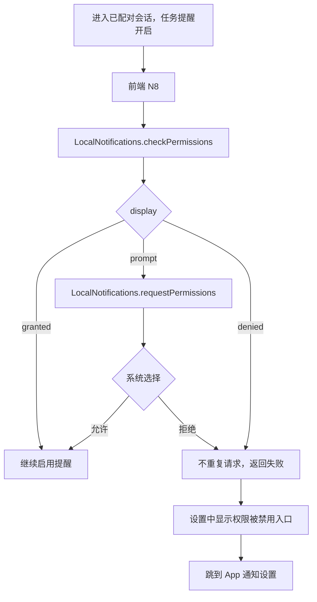
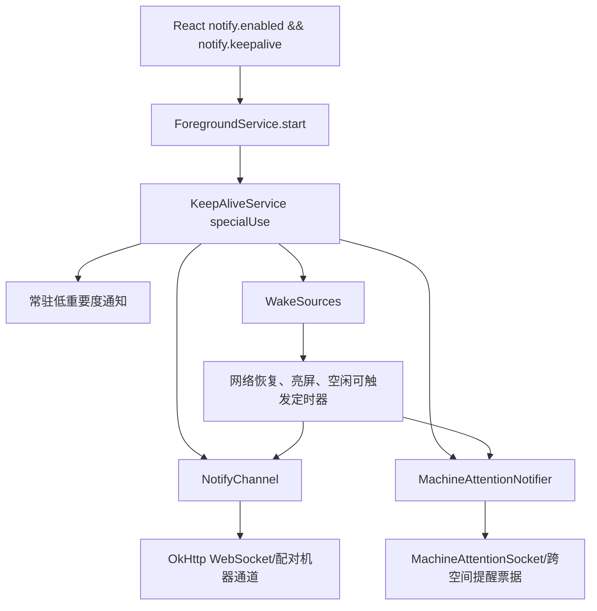

# 通知、权限与后台连接

## 权限不是一个开关

该 APK 申请的是**向用户展示通知**的权限。Manifest 没有通知监听服务的 `BIND_NOTIFICATION_LISTENER_SERVICE` 声明，不能把这里的实现理解成读取其他 App 的全部通知。

| 权限/能力 | APK 中用途 | 用户交互 |
| --- | --- | --- |
| INTERNET / ACCESS_NETWORK_STATE | 网络与连接状态 | Manifest 声明 |
| CAMERA | 二维码配对扫描 | 扫码功能/扫描插件处理；本次未做真机弹窗验证 |
| POST_NOTIFICATIONS | 展示任务和聊天通知 | Android 33+ 的运行时权限 |
| FOREGROUND_SERVICE | 保持原生后台服务 | 常驻服务通知 |
| FOREGROUND_SERVICE_SPECIAL_USE | `specialUse` 类型服务 | Android 原生服务声明和对应启动路径 |
| REQUEST_IGNORE_BATTERY_OPTIMIZATIONS | 请求电池优化豁免 | 打开系统授权页；不等于自动获准 |
| REQUEST_INSTALL_PACKAGES | APK 自更新安装来源 | 打开未知来源安装设置 |
| RECEIVE_BOOT_COMPLETED | 本地通知库的计划通知恢复 Receiver | **不证明自有 KeepAliveService 开机自动启动** |
| WAKE_LOCK | 声明于合并 Manifest | 本次不能仅凭声明断言自有业务一直持锁 |

完整声明见 [Manifest](../formatted/java/AndroidManifest.xml)。Manifest 还允许明文流量；Capacitor 配置 `allowMixedContent=true`。这些是所分析版本的事实，不是对新项目应默认采用的建议。

## 通知授权链路

前端入口 `app.js:191801` 的 `P0t` 只查询；`app.js:191822` 的 `N8` 查询后决定是否请求。非原生平台不会申请。通知设置切换为开启时也调用 `N8`；连接后的提醒初始化中默认通知开启时会调用，不只在用户手动打开设置后申请。

`Rvt` 中 `mobile.notify.enabled`、`mobile.notify.keepalive` 默认都为 true（值不等于 `"0"`）。权限失败不会自动把偏好值改成 false；**偏好开启与系统权限已授予是两层状态**。

原生 `LocalNotificationsPlugin`：

- Android <33：不弹 POST_NOTIFICATIONS 运行时对话框，返回系统通知允许情况。
- Android ≥33：通过 Capacitor 的 `display` 权限别名申请 POST_NOTIFICATIONS。
- 已拒绝时前端提供 `android.settings.APP_NOTIFICATION_SETTINGS`，附当前包名，交由用户恢复。

因此“开了 App 内提醒开关”不能保证通知一定出现，还需考虑系统总开关、通道、系统勿扰及后台连接。

## 前台与后台的提醒分工

`p1t` 把任务监控、通知点击和 foreground tracker 组织起来：

- 用户正在前台、且对应会话不在屏幕上：使用应用内部 notice 提示，可点击跳转。
- 当前会话就在屏幕上：避免对正在看的任务额外提示。
- 用户不在前台：Android 使用自定义 `AttentionNotifier.post`，其他平台另走本地通知分支。
- 重复任务通过稳定通知 ID 对齐同一会话；算法避开常驻服务使用的通知 ID `1001`。
- 聊天通知走 `postChat`、会话/线程分组、已读撤回等独立逻辑。

这是根据前端与原生代码追踪的分工；尚未在 Android 上验证所有前后台切换边界。

## 三个通知通道

| ID | 重要度 | 实现 |
| --- | --- | --- |
| `mirasim.keepalive` | 2，低 | 常驻通知，ID 1001，不显示角标，用于前台服务 |
| `mirasim.attention.v2` | 4，高 | 任务提醒，振动，锁屏私密可见性 |
| `mirasim.chat.v1` | 4，高 | 聊天提醒，振动，独立通道 |

`AttentionPoster.ensureChannel` 创建新任务通道时还会删除旧 `mirasim.attention`。`openChannelSettings` 打开的是任务通道，而不是所有通知通道。

点击通知后，`PendingIntent` 进入 `MainActivity`，附 `mirasim.notify.sessionKey` 或 `mirasim.notify.chatLink`。插件处理启动 Intent/后续 Intent，发出 `attentionTap` 或 `chatTap`；前端有 pending 缓冲，订阅者尚未挂载时先保留目标，挂载后消费。这是实现“冷启动点通知进正确页面”的关键。

## 可靠性引导

前端 `Zvt` 在允许的触发条件下等 1.5 秒检查三项，并以 `mobile.notify.setupNudged.v2` 记录已引导：

1. **电池优化**：`batteryStatus` 读 `PowerManager.isIgnoringBatteryOptimizations`；未豁免才建议打开 `REQUEST_IGNORE_BATTERY_OPTIMIZATIONS`。
2. **厂商自启动**：只有能解析到厂商设置 Activity 时展示。支持代码包括 Xiaomi/Redmi/Poco、Huawei/Honor、Oppo/Realme、Vivo/iQOO、Samsung、OnePlus、Asus、Letv、Nokia。
3. **提醒通道**：对 Xiaomi/Redmi/Poco 有额外建议；其他有后台设置需求的设备也可能提示声音/横幅。

UI 对厂商页、通道页区分“已前往”与“已开启”。前者只是用户点开过设置，**不表示系统已授予**。电池优化返回前台后会复查真实状态。

厂商 Activity 列表来自此 APK 的硬编码候选与 `resolveActivity`；不能保证其在所有新系统上仍有效。自启动页本身也不是 Android 通用运行时权限弹窗。

## 原生保活结构

`KeepAliveService.onStartCommand` 默认返回值 1（START_STICKY）；STOP 分支清理通道、通知和服务，返回值 2（START_NOT_STICKY）。Android 34+ 传递 specialUse 前台服务类型；Manifest 附用途说明。START_STICKY 是系统重建意图，不是永不被杀的保证。

`NotifyChannel` 使用 OkHttp WebSocket，30 秒 ping、120 秒无入站判死、3 秒起指数退避至 120 秒。它知道前端 `jsAlive` 时间，并在部分通道处理里结合前后台/JS 活跃状态避免重复工作。

`MachineAttentionSocket` 是另一条状态化连接：普通退避 3～120 秒、±20% jitter，认证等待 15 秒；协议不兼容等情况使用更长的 5 分钟～1 小时退避。票据失效会清理并通知前端续期。

`MachineAttentionNotifier` 对同一机器/房间按 seq 排序、过滤 reaction 和自己产生的提醒，等待 2 秒合并；投递前经 `ChatRowLedger.wasSeenByApp` 避免已在 App 展示的重复提醒。该决定投递的方法 Java 反编译失败，已补 [REA 方法证据](../evidence/rea-attention-delivery.json)。

`WakeSources` 监听 SCREEN_ON、默认网络恢复和一个每 10 分钟重新安排的 `setAndAllowWhileIdle` tick。系统可推迟空闲定时器，不应把代码中的 10 分钟当作真实精确唤醒 SLA。

## 凭据与持久化

- 配对/登录资料通过 `@aparajita/capacitor-secure-storage`，AndroidKeyStore + AES/GCM/NoPadding。
- 原生后台通道另有 `ChannelCredentialStore`，key alias `mirasim.channel.credential`，显式 256 位 AES key；SharedPreferences 存 IV 和密文；保存 channel credential、attention ticket 与序列进度。
- UI、会话缓存、transcripts 使用 Capacitor Preferences 的版本化 blob，而不是所有内容都写进敏感凭据存储。
- 开关和一次性引导标记有独立键；不要从 SharedPreferences 文件名推断其中数据都是明文。

## iOS 分支需要单独看

同一个前端 bundle 包含 `MirasimPush`、设备注册和推送测试接口，但 `$r()` 限制为 iOS 且插件存在。**不能把这些 APNs 注册逻辑归到 Android APK 的推送实现中。**本次 Android 的证据重点是本地通知与前台服务维护的原生连接。

## 新项目如何借鉴

界面层只表达“提醒偏好、系统权限、电池状态和引导步骤”，平台层封装“查询、请求、打开设置、服务启动/停止、投递、点击事件”。以返回前台后的真实查询刷新状态。若你的软件不需要持续连接或实时消息，就不必照搬此软件的完整后台通道系统。

## 证据入口

- `app.js:191560`～`192050` 生命周期与通知适配；`app.js:192941` 默认开关；`app.js:193340` 引导；`app.js:193801` 前后台分工；`app.js:205830` 通知设置。
- [ForegroundServicePlugin](../formatted/java/ai/mirofish/mirasim/ForegroundServicePlugin.java)、[KeepAliveService](../formatted/java/ai/mirofish/mirasim/KeepAliveService.java)。
- [AttentionNotifierPlugin](../formatted/java/ai/mirofish/mirasim/AttentionNotifierPlugin.java)、[AttentionPoster](../formatted/java/ai/mirofish/mirasim/AttentionPoster.java)、[VendorAutostart](../formatted/java/ai/mirofish/mirasim/VendorAutostart.java)。
- [NotifyChannel](../formatted/java/ai/mirofish/mirasim/NotifyChannel.java)、[MachineAttentionSocket](../formatted/java/ai/mirofish/mirasim/MachineAttentionSocket.java)、[WakeSources](../formatted/java/ai/mirofish/mirasim/WakeSources.java)。
- [REA 通知方法](../evidence/rea-notification-post.json)、[REA 服务启动方法](../evidence/rea-keepalive-start.json)。
