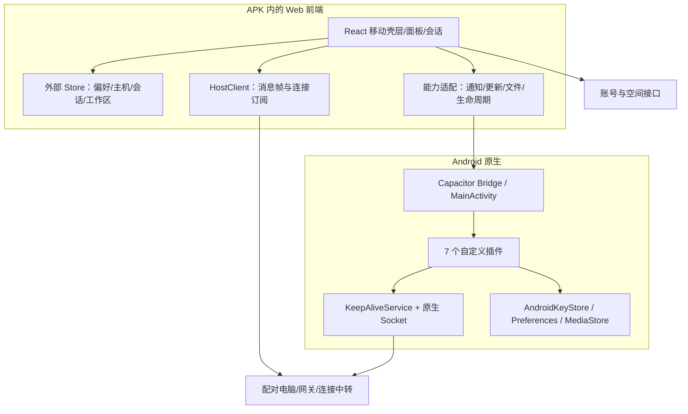

# 架构观察与新项目蓝图

## 已观察到的架构



### 前端运行与状态

`index.html` 以 module script 启动本地主 bundle。启动函数 `w3t`（`app.js:218060`）并行读取 UI store、会话缓存、主机配对与安装标识，恢复上次主机作用域，然后创建 React root。Capacitor 配置中没有把整个 UI 指向一个远程 server.url。

全局状态的实现暴露 `getState/setState/subscribe/getInitialState`，React 通过 `useSyncExternalStore` 订阅，并有 selector 使用方式；形态与 Zustand 相符。**这里可以确认外部 store 模式，但没有恢复原 package.json，不能宣称已核实其完整依赖版本。**

主机切换会销毁旧 client、resetHostScope、切换 transcript cache、载入新主机缓存、创建新连接。会话、工作区和当前页面不是直接储存在 Android Activity 字段中。

### 数据分层

| 数据 | 原有入口/键 | 用途 |
| --- | --- | --- |
| UI/显示状态 | `mirasim.ui-store.v1` | 由 Preferences blob 读写 |
| 会话/工作区缓存 | `mirasim.sessions-cache.v1` | 以主机作用域组织 |
| 对话文本缓存 | `mirasim.transcripts-cache.v1` | 切主机、forget/flush |
| 配对资料 | `mirasim.hosts.v1` | 使用 SecureStorage 抽象保存 |
| 活跃会话 | `mobile.active-session.*` 等 | 恢复上次所处会话/目录 |
| 更新偏好 | `mobile.update.autoCheck`、`mobile.update.beta` | 轻量 UI 偏好 |
| 提醒偏好/引导 | `mobile.notify.*` | 与系统授权分开保存 |
| 原生后台凭据 | `ChannelCredentialStore` | AndroidKeyStore 密钥 + 加密 Preferences |

普通偏好、可重建缓存与敏感凭据分开，是这套架构适合保留的边界。缓存不是服务端事实来源；切换账号/主机时需要清理作用域。

### 七个自定义原生插件

| 插件 | 实际 PluginMethod 入口 | 核心职责 |
| --- | --- | --- |
| `ApkUpdater` | `canInstall/requestInstallPermission/download/install` | APK 更新 |
| `AttentionNotifier` | `post/postChat/cancel/chatAttentionSeen/withdrawChat/openChannelSettings/deviceProfile` | 系统通知、通道、点击事件 |
| `ForegroundService` | `start/stop/jsAlive`、凭据/票据同步、`batteryStatus/requestBatteryExemption/vendorAutostartAvailable/openVendorAutostart/openNotificationSettings` | 后台连接与设置入口 |
| `SaveFile` | `save` | Android 29+ 使用 MediaStore Downloads 保存分享文件；旧系统返回 saved=false 供前端回退 |
| `EdgeGesture` | `setLeftEdgeClaimed` | 系统手势排除矩形 |
| `LandscapeLock` | `setLandscape` | 横屏/自动旋转控制 |
| `WindowFloor` | `setColor` | 原生窗口/WebView 背景一致 |

它们都在 `MainActivity.onCreate` 注册。另有公开 Capacitor 插件：App、Browser、Filesystem、Keyboard、LocalNotifications、Preferences、Share、StatusBar、SecureStorage 和条码扫描等。内置插件与自定义插件是两种来源，不能只读 `capacitor.plugins.json` 就算盘点完成。

### 连接、认证与接口

前端常见通信边界为 client.post(frame)、onFrame、onConnection；帧有 type 区分业务事件。UI 订阅业务状态，连接细节由 client 和对应 transport 管理。所见代码包含直接连接、网关、连接中转及新版协议相关路径，不能仅凭名称保证每条路径都可由当前平台使用。

客户端静态出现的地址：

| 边界 | 字符串观察 |
| --- | --- |
| 认证服务 | `https://auth.mirasim.ai` |
| 空间/网关 API | `https://relay.mirasim.ai` |
| 配对连接中转 | `wss://mirachannel.mirasim.ai/mirachannel/rendezvous` |
| OAuth 回调 | `https://mirasim.ai/app/auth/callback`，Manifest 中有对应 Intent Filter |
| 发布元数据 | `https://cdn-assets.mirasim.ai/mirasim/releases/latest.json` |

还可追到 OAuth providers、邮箱认证、token 刷新、`/v1/machines`、`/v2/machines`、`/v2/gateway/session`、`/v2/gateway/attention`、成员/邀请/访问日志/credit/owner-transfer 等请求构造。账号刷新使用 WeakMap 中的进行中 Promise 避免同一存储实例多次并发续期；没有找到有效登录时返回 signed-out 状态。

完整**字面量索引**见 [frontend-endpoints.json](../evidence/frontend-endpoints.json)，动态模板索引见 [frontend-apiTemplates.json](../evidence/frontend-apiTemplates.json)。其中也含占位文案和第三方库字符串，不能把每个匹配都当成业务 API；动态模板与接口字段仍需沿函数阅读。此次没有调用它们测试账号或获取数据。

## 建议给你新软件采用的目录

下面是**新的开发组织建议**，不是从 APK 恢复出的原仓库目录。

```text
src/
  app/                     # 启动、依赖注入、错误恢复、根组件
  shell/mobile/            # 主布局、抽屉、面板栈、返回优先级
  design/                  # tokens、theme、字体、可访问性
  components/              # Group、Row、Switch、Segmented、Sheet、Composer
  features/
    onboarding/            # 登录、扫码、配对
    sessions/              # 会话列表、对话、输入
    settings/              # 主题、语言、字号、空间详情
    notifications/         # 偏好、权限状态、可靠性引导、点击路由
    updates/               # 版本源、状态机、更新展示
  domain/                  # 稳定业务模型；不依赖 Capacitor
  transport/               # HostClient、重连、消息帧校验、连接状态
  storage/                 # public preferences、vault、版本化 cache
  platform/
    ports/                 # TypeScript 能力接口
    capacitor/             # Android/iOS 适配
    web/                   # 浏览器能力与受限降级
android/
  app/src/main/java/<你的包名>/
    MainActivity.java
    plugins/               # 仅实际需要的系统能力
    background/            # 如业务需要持续连接，服务与 socket 分开
```

### UI 基础组件建议

第一轮实现 Group、SettingsRow、Switch、SegmentedControl、IconButton、Drawer、Sheet、Notice、Composer；让它们只依赖语义变量，不直接调用 Android 插件。主题切换写根节点属性；业务组件不堆积条件色值。

### 系统能力接入顺序

1. 先跑通 Web 壳层、主题、设置与本机持久化，验证深浅色、大字和返回行为。
2. 接入 Capacitor 与安全存储、生命周期、相机扫码和文件分享。
3. 接入通知：状态查询、按需请求、拒绝入口、通道及点击冷启动路由。
4. 接入 APK 更新：自有发布源、摘要校验、安装许可往返、系统安装器，补全实际版本验证。
5. 确认业务确实需要后再加后台服务、唤醒和厂商引导；用真机测量效果。

## 已提供的独立参考实现

- [ports.ts](../reference/ports.ts) 描述能力边界；调用方不依赖实现。
- [update-policy.ts](../reference/update-policy.ts) 提炼 APK 更新解析与状态规则，保留简化版本比较局限。
- [permission-policy.ts](../reference/permission-policy.ts) 提炼权限和引导决策。
- [design-tokens.css](../reference/design-tokens.css) 是原界面计算变量快照。

这些材料足以作为下一步新项目的规格和部分基础逻辑，但当前没有生成新的业务后端、完整 Capacitor 工程或可发布 APK。
