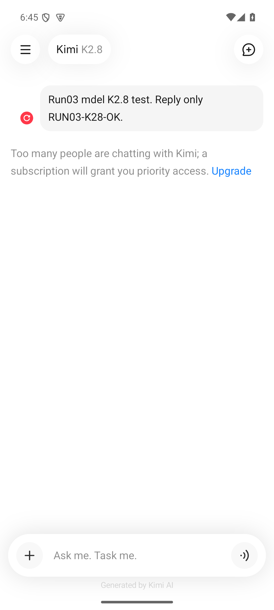
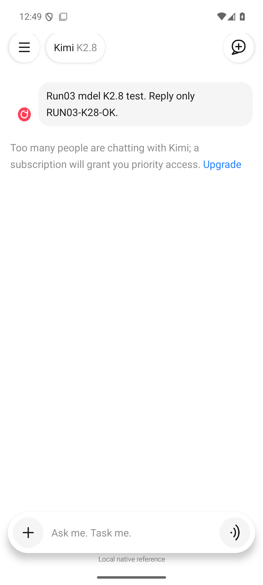
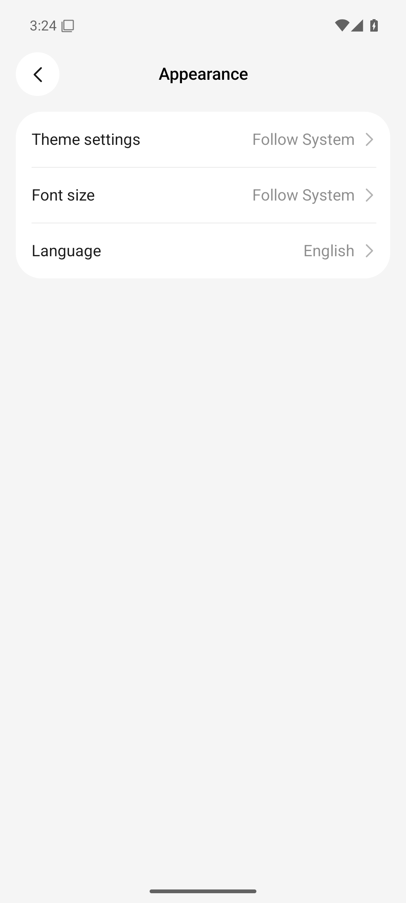
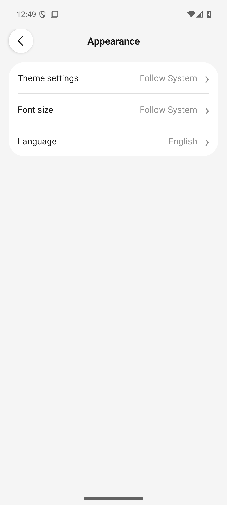

# 原版 A ↔ 原生参考 D · Run03 对照

已完成约定的代表页面对照、实质布局修复与重拍。**这证明对照工作已执行，不表示像素一致、原版全部功能还原或原版后台已验证。** 独立参考自测见 [逐项验收与精确证据](../reference/run03-acceptance.json)，不同业务另见 [Fieldnotes 验收](../transfer-example/run03-acceptance.md)。

原版为 `com.moonshot.kimichat`，3.1.3 / code376，APK SHA-256 `9637623695b36eaba1639a6c346310ef05b2a9d478332dcbc5e934cc94dd8332`。最终 D 为 `org.research.kimistyle`，SHA-256 `057196b83df26f4ae47da0181d1af7c89fda2423f92b9bfb147c7575837ca140`，Java Android View/EditText/Dialog/Canvas。D 无 WebView、网络权限、账号、模型或订阅服务。

两者使用同一专用 AVD `rea_kimi_ui_20261015` / `emulator-5596`，Android 15/API35、1080×2400 物理 px、420dpi、density 2.625、fontScale 1.0、竖屏。主配对均为浅色、英语、Follow System 字号。原版正常登录，D 无账号。A 的 `systemLocales` 当时读为字符串 `null`，但 buildLocale 和 App locale 明确为 en-US；D 系统读为 en-US。不能把这项观测差异抹掉。状态栏时间、通知图标及后台条件也不同。

截图先于 UIA，均为非原子采集；控件语义边界不等于字形墨迹边界。以下物理 px 均只适用于这些帧，`dp = px / 2.625`。原图未裁切、覆盖或重绘。A 的原始采集时间和 origin 保留；本次查看历史资料不会生成新 A。所有 D 原图逐张以 `view_image` 查看，并另读 XML、元数据和 SHA，分享名单绑定 [精确字节](../docs/native-reference-safe-scenes.json)。

## 主配对：相同容量失败内容

| 原版 A：r03-06，2026-10-16 06:45:30.897Z | 最终 D：nr03-020 |
| --- | --- |
|  |  |
| [A capture / 条件 / SHA](../evidence/runtime/run03-20261016/scenes/r03-06-k28-request/capture.json) · [XML](../evidence/runtime/run03-20261016/scenes/r03-06-k28-request/hierarchy.xml) | [D capture / 条件 / SHA](../evidence/reference/run03-20261016/scenes/nr03-020-capacity-final/capture.json) · [XML](../evidence/reference/run03-20261016/scenes/nr03-020-capacity-final/hierarchy.xml) |

保留准确输入 `Run03 mdel K2.8 test. Reply only RUN03-K28-OK.`，包括实际出现的 `mdel`，没有替换成命令原意。两帧均显示 Kimi K2.8、右侧用户气泡、左邻红色重试、下方灰色容量说明与蓝色 Upgrade；无完成思考卡片、回答工具栏或顶部 More。长输入和说明均以相同单词换行。

| 核对点 | A | 最终 D / 判断 |
| --- | --- | --- |
| 导航语义目标 | `[37,131][163,257]` | 完全同 bounds，126×126px = 48×48dp；不推出所有原版目标均为48dp |
| 新建语义目标 | `[917,131][1043,257]` | 同 bounds；D Canvas 图形的线条、尾部形状仍不同 |
| 容量说明 TextView | `[42,569][1038,707]` | `[42,571][1038,710]`，顶部低2px、底部低3px；同内容/换行，不等于字形一致 |
| 用户消息 | A 文本节点 `[190,357][1006,495]` | D 整个带内边距 TextView `[158,337][1038,518]`；节点语义范围不同，不能直接把矩形差算成文本错位 |
| 加号输入目标 | `[53,2122][179,2248]` | 同 bounds；D 语音目标左侧901px，A为900px |
| 输入字段语义范围 | `[211,2122][900,2248]` | `[179,2156][901,2213]`，D 的内边距、文字布局及可访问性范围不同；视觉 placeholder 起点接近，但语义等价未成立 |
| 页脚 | Generated by Kimi AI，浅灰 | Local native reference，较深，保留独立实现披露 |

D 可见圆按钮使用整个原生 View 背景；A 的可见圆形较小、阴影更柔和。D 原生 elevation 阴影更集中，输入器下缘更深。重试图标为独立 Canvas 绘制，弧线和抗锯齿有可见差异。D Android 默认字体/字体回退、字重和 font padding 为独立选择；未查明原版运行字形实际 family、轴、逐字回退，因此不宣称字体还原。

行为分别核对：A 是真实服务容量失败；D [Upgrade](../evidence/reference/run03-20261016/scenes/nr03-064-capacity-explanation-final/screen.png) 只开本地说明，且整个说明 TextView 可点，A 的 span 点击范围未在该对照中验证。D [Retry 后](../evidence/reference/run03-20261016/scenes/nr03-065-capacity-retry-final/screen.png) 由6000ms本地回调再次失败；它没有提交模型请求、访问订阅或证明原版重试的后台语义。

## 主配对：相同 Appearance 值

| 历史 A：12-appearance，2026-10-15 15:24:03.268Z | 最终 D：nr03-021 |
| --- | --- |
|  |  |
| [A capture](../evidence/runtime/scenes/12-appearance/capture.json) · [XML](../evidence/runtime/scenes/12-appearance/hierarchy.xml) | [D capture](../evidence/reference/run03-20261016/scenes/nr03-021-appearance-final/capture.json) · [XML](../evidence/reference/run03-20261016/scenes/nr03-021-appearance-final/hierarchy.xml) |

均为 Theme settings / Follow System、Font size / Follow System、Language / English，白色圆角分组、两道分隔、右值与箭头。D 标题和箭头明显更粗，返回按钮有更集中的原生阴影；A 的返回圆面更平、细线箭头更长。D 行分隔较深、较厚，后两行累计略低。D 语言行是英文边界说明，不实现原版语言切换。

只对这两张 PNG 作像素抽样：中心列 x540 中，近白色（RGB各分量>250）的三段为 A `297–443 / 446–591 / 594–739`，D `296–442 / 446–592 / 596–742`；末行底缘差3px。两图 `(540,900)` 像素均为 `(245,245,245)`，这是当前浅色页面的合成像素，不升级为所有页面全局色 token。A 文本节点只包文字，D 标签节点铺满行，因此 UIA 行高不能直接当文字行高对照。

行为保留了已有 A 证据中的“主题立即生效；字号预览 Back 放弃；Save 提交并回主页”。最终 D [预览](../evidence/reference/run03-20261016/scenes/nr03-022-font-preview-final/screen.png) → [Back 重入 Follow System](../evidence/reference/run03-20261016/scenes/nr03-023-font-abandoned-final/screen.png) → [Save 回主页](../evidence/reference/run03-20261016/scenes/nr03-024-font-saved-home/screen.png) → [摘要 Extra Large](../evidence/reference/run03-20261016/scenes/nr03-025-font-applied-summary/screen.png) 均已真实执行。D 预览文字、字号比例、默认 Android 字体和保存实现为 D，不称原版精确字号。D [深色即时切换](../evidence/reference/run03-20261016/scenes/nr03-026-theme-dark/screen.png) 与 [返回摘要](../evidence/reference/run03-20261016/scenes/nr03-027-dark-summary/screen.png) 也已执行，最后恢复 Follow System。

## 额外组件与行为对照

| 对照 | A 安全原图 | 最终 D 安全原图 | 具体差异和边界 |
| --- | --- | --- | --- |
| 完成页，相同 Reply only OK → OK、Instant High | [r02-21](../evidence/runtime/run02-20261016/scenes/r02-21-first-complete/screen.png) | [nr03-036](../evidence/reference/run03-20261016/scenes/nr03-036-complete-source-content/screen.png) | D 无思考灯泡，只有 Copy/Retry 文字胶囊；A 有朗读、复制、反馈、重试、分享图标。D 的新建图标为加号，原版是带加号气泡。D “Thinking complete”更靠左，字形/基线和页脚不同。该D帧为内容配对fixture；真实Send另见nr03-030。 |
| 删除确认，相同标题和按钮 | [r02-45](../evidence/runtime/run02-20261016/scenes/r02-45-delete-confirmation/screen.png) | [nr03-037](../evidence/reference/run03-20261016/scenes/nr03-037-delete-dialog/screen.png) | 背景内容不同，只比较弹层；y1210近白色横段 A x172–906、D x93–985，D 明显更宽。D标题左对齐且按钮更轻；源Cancel已观察，D另执行Back/外侧关闭/确认，不把独立关闭策略归为A。 |
| 原生键盘与焦点 | [历史r02-07](../evidence/runtime/run02-20261016/scenes/r02-07-unsent-draft/screen.png) | [nr03-019](../evidence/reference/run03-20261016/scenes/nr03-019-keyboard-final/screen.png) | 草稿、模型及顶部提示不同，是组件比较，不能称同内容画面对齐。均真实Gboard；A 输入器多行区内下置动作，D单行输入与动作横排。A 键盘为发送箭头，D为换行键。D字段focused=true，composer已避开IME；Back先隐藏键盘。 |

原版短草稿导航保留与字号返回语义来自历史 A；本轮原版长草稿/更多行为应读主研究证据。D 自己的 [导航保留](../evidence/reference/run03-20261016/scenes/nr03-028-chat-draft-navigation/screen.png) 和 [无scene重启保留](../evidence/reference/run03-20261016/scenes/nr03-029-chat-draft-process/screen.png) 均通过，但D显式SharedPreferences不能证明A使用同一持久化机制。D页面/状态刷新整体替换View，焦点与选区可能重置；未声称与原版组合输入或焦点生命周期一致。

D 的普通错误页还会显示 Thinking complete 和文字 Retry，与原版离线气泡旁红重试结构不同；容量专用配对已单独处理。D错误恢复固定回 OK，不执行离线测试，也不保证回答遵循输入。D6秒为fixture设定，不是A动画/生成耗时。最终 D 实际 Retry 后3.362s触发Stop，停止后9.800s的截图仍为 [Output stopped](../evidence/reference/run03-20261016/scenes/nr03-031-real-stop-late-final/screen.png)。这些是主机动作时间边界，不是精准回调或动效测量；A的停止仅已证UI停止，未证明后台请求取消。D进程中断后busy→stopped、notes busy→error都是独立恢复策略。

## 修复与最终构建复核

| 实质问题 | 保留的失败/旧构建证据 | D修复与最终重拍 |
| --- | --- | --- |
| 系统顶部inset重复，导航比A低73px | [nr03-002](../evidence/reference/run03-20261016/scenes/nr03-002-capacity-before/screen.png)，y204–330 | edge-to-edge系统布局/cutout与明确顶部padding；最终nr03-020导航y131–257，Appearance nr03-021组顶也已对齐 |
| 负margin圆面/阴影被父容器裁切 | [nr03-001](../evidence/reference/run03-20261016/scenes/nr03-001-empty/screen.png) | row/column关闭子级和padding裁切；最终20/21/71复核；原生阴影与A仍不同 |
| 原生键盘打开时composer藏在IME后 | [nr03-010](../evidence/reference/run03-20261016/scenes/nr03-010-keyboard-draft/screen.png) | API30+显式IME/nav inset差值；最终nr03-019字段y1336–1393、动作y1302–1428，键盘上方可见 |
| Font Save标签换行 | [nr03-017](../evidence/reference/run03-20261016/scenes/nr03-017-font-preview/screen.png) | trailing按钮8dp内边距和singleLine；最终22/23的Save完整单行，且实际提交24/25成功 |

修复均为 `MainActivity.java` 的 D 平台映射。构建/签名与15项状态不变量检查通过，之后最终APK真实安装并重新跑关键路径。**001–018共18帧属于已替换构建，只作修复证据；即使旧文件名含final也不代表最终构建验收。019–071共53帧属于最终SHA。** 原图和各自artifactSha256保持原值，未把旧帧重标为新build。

最终 [设置恢复](../evidence/reference/run03-20261016/scenes/nr03-070-restored-preferences/screen.png)、[空主页](../evidence/reference/run03-20261016/scenes/nr03-071-restored-empty/screen.png) 后仅停止D；唯一设备控制权已交回主代理。未启动原版、未控制其他模拟器，AVD最终恢复/关闭由主代理另外记录。R02按以上代表范围验收；字体精确匹配、所有图标/功能、真实服务、其他尺寸/平台、TalkBack、RTL和动画参数均不在这个已验证结论中。
