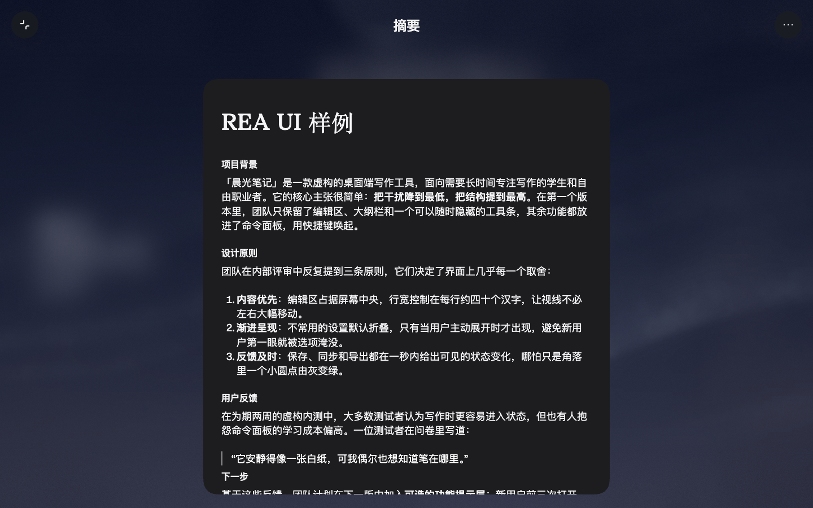
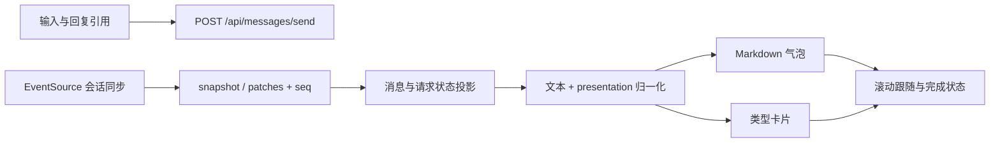

# Hark 聊天界面分析

可先打开 [截图对照与流式时序查看器](evidence-gallery.html)：七组实际截图可切换对比，滑块显示普通文字样例的实测到达节奏。

当前版本的核心是**结构化消息、可归一化的卡片、独立详情查看器、SSE 同步与动态天空背景**。界面里的模型自述和它生成的虚构 schema 没有用于推断内部实现；卡片类型与逻辑来自已发布消费者代码，视觉参数来自 CSS 与节点计算样式，交互来自实际操作。

采集日期：2026-10-15。使用用户完成登录的独立 Chrome/CDP 会话，桌面主要视口为 1440×900，另验证 390×844。不同快照有不同 DPR/视口，坐标以各自文件为准。详细证据分别见 [设计分析](design-analysis.md)、[卡片代码分析](card-code-analysis.md) 和 [运行实测](runtime-analysis.md)。

## 六个重点的结果

| 重点 | 提取结果 | 证据与覆盖 |
|---|---|---|
| 交互卡片 | 已辨识真实 `presentation` 归一化和 renderer 表；实测 summary、table、code、links、images 和文件预览 | 类型代码 + 截图 + 操作记录；订单、航班等仅静态覆盖 |
| 文字排版 | 正文/输入框 15/19/400；代码 14/20 mono；摘要详情正文 18/25.2，标题 Hark Serif 40/52 | 计算样式；不同组件作用域分别记录 |
| 背景 | 全屏 WebGL 天空，含云噪声、调色、LUT、颗粒与冻结/占位层；卡片叠透明材质 | 保存完整 wallpaper HTML、shader 与 CSS；天气参数全分支未实测 |
| 设计变量 | 544 个带原选择器的变量声明；主题、字体、间距、连续圆角、blur 与层级 | [CSS](design-tokens.css) / [JSON](design-tokens.json)，保留压缩名与作用域 |
| 流式输出 | EventSource 的 snapshot/patches + seq + entry/message 状态更新；流式 Markdown 有独立处理 | 实际 SSE 与代码吻合；测试样例未出现逐 token 正文增长 |
| 卡片交互逻辑 | 展开/折叠、回复引用、摘要弹层、图片栈展开/锁滚动、CSV 下载、文件查看器 | 前后状态实测；排序、工具取消、断线恢复等另标静态或未触发 |

## 卡片结构与交互

消费者链路为 `message → HO → PO[presentation.kind] → Zge[normalized.kind]`，有明确类型映射，也会从完整 code fence、Markdown table、纯链接或图片内容识别卡片。`product_grid`、`flight_list` 可能从 `table` 的列与内容语义派生，不能把所有归一化 kind 当作服务端同名协议字段。

| kind / 层 | 关键形态 | 展示与交互 |
|---|---|---|
| `link` / `links` | url；links 的 url/label/title/image | metadata/unfurl 异步补全；1/2/3/≥4 的不同栈布局，外链新标签页 |
| `images` / `attached_images` | url/caption 或图片附件 | 比例驱动尺寸；少量叠放，多张可展开为两列图集 |
| `summary` | markdown/title/source | 压缩预览，点击主体进入独立摘要弹层 |
| `code` | source/language/title | mono 预览；内容溢出才提供展开、收起，支持上下文菜单和回复 |
| `text_template` | body/title | 保留文字格式，与普通 Markdown 段落不同 |
| `table` | columns/rows/title/ornament/row_sites | 自适应 grid/scroll、复制、CSV 导出；代码有排序状态 |
| `product_grid` / `flight_list` | 归一化 table | 商品列表、航班列表分支；当前分发商品使用 list 变体 |
| `order_summary` / `declined` | 订单明细/动作；关联 messageIds | 订单/行程摘要、拒绝原因分支；未执行真实订单动作 |
| 文件/网站 artifact | attachment viewer 或 project/tool 标识 | 独立预览层，不能等同于 chat presentation.kind |

字段表是客户端消费者形态，完整分支与定位见 [卡片代码分析](card-code-analysis.md)，不是声称获得完整服务端 schema。

实测代码卡的 disclosure `aria-expanded` 从 false 到 true，再回到 false；卡片回复让输入框进入“回复消息”状态，Escape 可退出。summary 打开 `[role=dialog]` 详情，关闭后返回原对话。七张图片的 `pile` 栈展开后移入 overlay，scroller 加 `is-locked`，展开按钮变为 `Hide all photos`；Escape 后最终 `spread=0`、`locked=false`、`aria-expanded=false`。动态图层切换有延迟，所以记录瞬时和最终状态。

双链接样例实际是 `data-layout=two`，两张 `<a target=_blank rel="noopener noreferrer">`，没有“全部展开”按钮。多卡展开不能套在所有两张卡片上。表格下载得到 UTF-8 BOM CSV，列和行与虚构内容一致；**此样例点击评分列头三次没有改变行序**，只能确认排序代码存在，不能声称此卡已可用排序。文件 `demo_todos.csv` 打开独立查看器，经加载后出现列字母、行号与下载按钮。所有操作证据见 [运行实测](runtime-analysis.md)。

## 排版与视觉参数

| 部位 | 本次实测 |
|---|---|
| 普通消息、输入框 | GT Standard L，15px / 19px / 400；气泡左右16、上下14.5px；最小高度48px |
| 普通气泡 | 24px nominal radius + 动态连续 Bézier clip-path；桌面常见上限424px |
| 代码卡正文 | GT Standard Mono，14px / 20px / 400；padding `0 16px 16px` |
| 链接卡标题/来源 | 15px / 19.5px，标题500、来源400；标题最多两行 |
| 摘要详情标题 | Hark Serif，40px / 52px / 500 |
| 摘要详情正文/粗体 | 18px / 25.2px，400 / 600；h2正文分段16px/22.4px/700 |
| 输入玻璃层 | `backdrop-filter:blur(50px)`，24px连续圆角，独立 fill/stroke span |
| dark 消息填充 | user `rgba(29,29,31,.3)`；agent `.7`；无相同的 composer blur |
| dark 通用卡片/输入填充 | 原变量 `.618`，浏览器计算序列化约`.62` |

`body` 实测是16px，组件自身覆盖为15px。不要把所有正文设为同一字号：摘要详情有更大的阅读排版；内嵌 Markdown、quoted pre、专用 code card 也分别使用不同规则。[计算样式证据](../evidence/styles/rich-computed-styles.json) 与 [原样式说明](design-analysis.md) 保留这些差异。

桌面首页面板列默认420px，聊天内容与输入带512px；普通气泡更窄。390px视口实测输入条 x=16、宽358、高48，距底32px，消息列表铺满390px，没有文档横向溢出，字体仍15/19。窄屏 screenshot 与 [几何 JSON](../evidence/styles/27-mobile-layout.json) 保存同一时点；后续已恢复桌面视口。

## 背景和变量

天空在 `#sky-root` 中：`#gl` WebGL、`#skyfreeze` 冻结层、`#skyph` 低分辨率占位和失败层。当前页面实际 canvas 可见；层本身 CSS 背景透明，画面由 shader 绘制。核心 HTML 已保存，[fragment shader](../evidence/scripts/wallpaper-fragment.glsl) 中包含四 octave FBM/domain warp、四段天空渐变；CPU 提供太阳/月亮、云层与色调参数，后处理包含 vignette、33³ LUT、暗部蓝色下限和颗粒。静态 DPR cap=1.75、绘制31ms门限、场景2.5s交叉淡化；这些配置不等于本次完整天气算法性能实测。

[变量导出](design-tokens.css) 保留 `:root`、theme selector、`.mr6c8q0`、`.rh8xfp0` 等原作用域。语义颜色如 `--text-primary`、`--bubble-agent-bg` 有原名；压缩的 spacing/font/radius 名称仅按使用位置推断，JSON 明确标注。544是**声明数量，含主题/作用域下重复名称**，不是544个全局唯一名字。

连续圆角宿主背景通常透明，真正 fill/stroke 在按尺寸计算 `clip-path:path(...)` 的子层。如果只读取宿主背景或复制 `border-radius:24px`，会遗漏最终材质和形状。设计分析保存原路径算法与当前节点值。

## 同步、流式输出与滚动

实测 `/api/sync/conversation` 与 `/api/user/events` 返回 `text/event-stream`；conversation 有 snapshot、约15秒 ping，以及递增 seq 的 patches。页面重载后可在 page target 观察到 conversation SSE，先前发现的 `hark-connections` SharedWorker 则采到 domain 通知。这与代码“优先 SharedWorker、可回退 in_tab”一致；采样没有保存 mode 的值，因此不能仅从 target 断言所有连接的具体 manager mode。

短文字测试从 POST 到正文出现约10.6秒。SSE seq936–942 含 `entry_add`、`request_update`、`narration_update` 与 `message_update`；assistant entry 的 content 形态一次已为82字符，UI第一次可见即为完整正文。本次没有观察到逐字或逐token增长。多卡测试则在约53.4秒批量出现 text/summary/table/code/links。**已证实实时同步，未以此两次样例证实服务端 token 粒度输出。** [去值事件形态](../evidence/network/13-sse-metadata.json) 和 [DOM 100ms采样](../evidence/interactions/13-sse-dom-samples.json) 可复查。

代码中的文本流式路径会处理未闭合 Markdown、thinking/streaming/settled、最后缓存解析。另一个 RAF reveal helper 的90 chars/s用于工具活动显示；不能把它当作普通聊天实测速率。滚动 near-bottom70px、用户上滚/选区退出锁定、ResizeObserver追随增长均有静态证据。本次新卡出现后滚动逐步靠近底部，上滚时出现“滚动到底部”入口；未覆盖所有 detach/paused分支。

工具 Stop 存在确认、dispatch筛选、乐观cancelled与失败回滚分支，未执行工具取消；普通文字测试未出现可确认的全局 Stop 按钮。订单动作、连接外部账户和真实待办变更也未触发。

## 覆盖范围与证据复查

REA页面脚本证据 `ev_4d515902…`、资源导出 `ev_f59cba60…`、成功代码场景 `ev_e41e6662…`、最终页面 `ev_57579bb8…` 与截图 `ev_0e3b1745…` 的完整 ID 和文件位置在 [证据索引](../evidence/index.json)。同源读取被 Cloudflare拦截的结果也保留，最终CSS来自浏览器实际加载内容而非403页面。

本次覆盖当前已登录版本的可见卡片、暗色视觉、窄屏几何、源码静态分支与两次生成时序。浅色主题运行、完整服务端schema、所有账号/权限/lazy资源、断线恢复执行、真实订单/航班操作、工具取消、所有动画阈值的实际拖动测试仍未验证。未找到专用聊天 `todo`/`plan` kind：首页任务面板、活动phases和文件viewer是独立层，不能根据模型生成文案混同。

登录由用户完成。日常Chrome原会话没有暴露REA所需CDP端口，因此采用独立profile；这不表示日常Chrome不可用，有可连接的CDP时同样可采集既有登录状态。报告与原始资产均位于当前项目。
