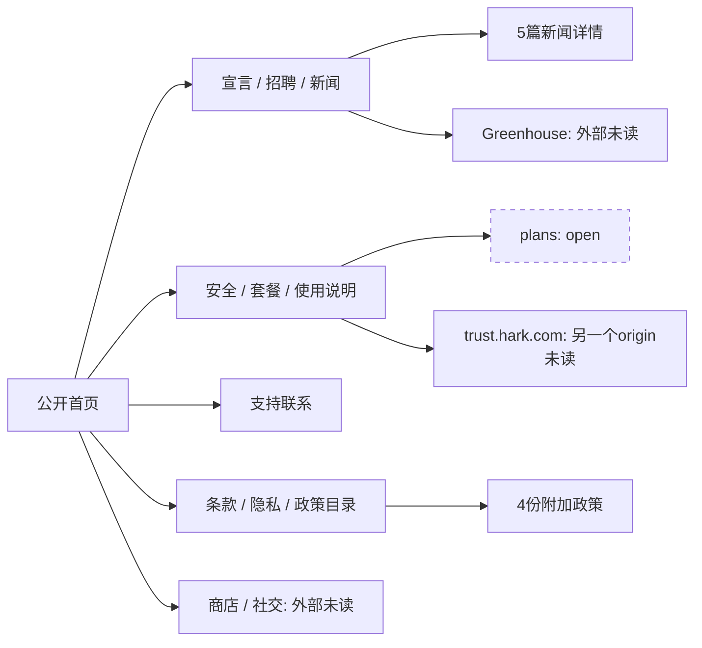

# Hark公开内容与链接地图 · 2026-10-22

这一步已整理本轮保存的 **20条公开路由**：首页，加19组JSON/HTML；覆盖5篇新闻、6份法务正文及政策目录、招聘和支持。它记录第一方公开内容与页面类型，**用户要求的原版最深UI、完整资产和当前登录App研究仍在进行**。本子任务只读本地文件，没有联网、浏览器控制、表单提交、像素复核，也没有改13个标准包入口或原件。

来源身份为 `https://hark.com`，public部署 `dpl_43vpACitAoHemg5zATXXCP8hBYHa`。摘要均以自己的中文表达；官方能力、性能、安全/隐私承诺和法律约定是页面声明，本地图不证明后台实现、第三方公告真伪或实际法律执行。历史App与D参考不并入当前公开页A。完整机器图为 [site-content-map.json](site-content-map.json)，含每页实际capture interval、全部文件SHA、控件元数据、411条合并边及97个URL目标（包括明确标出的纯文本URL）。

## 公开页面目录

| 官方页面 | 捕获标题 | 内容摘要 | 设计类型（源结构） |
| --- | --- | --- | --- |
| [公开首页](https://hark.com/) | Hark | 首页把Hark Pro介绍为处理日常和长期任务的个人智能系统。五组说明围绕持续聊天与项目、云端Handoff、敏感凭据保护、可执行Action Buttons和可自定义Panels展开，并连接注册、公司资料、政策及下载入口。 | 动态天空与媒体首屏 / 共享提供商/邮箱注册入口 / 3D任务演示轮播 / 交替图文Feature / 安全/宣言CTA / 分组页脚 |
| [使用说明与FAQ](https://hark.com/using-hark) | Using Hark Pro \| Hark | FAQ解释Home、Chat、Projects三个主要视图，集中介绍Handoff、记忆、Panels、Action Buttons、Specialties、定时任务和API Services。另说明订阅/自动充值、数据删除与凭据保护、支持/反馈入口，以及产品对AI关系和有害行动的立场。 | 说明标题与导语 / 多章节FAQ accordion / 官方App架构与功能目录 / 订阅/安全/AI立场章节 |
| [套餐与使用额度](https://hark.com/pricing) | Pricing \| Hark | 页面展示基础Pro免费、Pro²每月20美元获得2倍用量、Pro³每月100美元获得10倍用量，并说明升级增加使用额度而不划分功能。两个升级动作都指向尚未采集的/plans。 | 三列套餐卡 / 中列强调表面 / 窄屏radio选择器 / 价格/权益/CTA分层 / 注册尾段 |
| [安全说明](https://hark.com/security) | Security \| Hark | 安全页陈述数据所有权、不售卖和不用于广告的承诺，围绕保护、透明、权限、平衡与基础规则组织说明。默认文本以加密保险库和传输保护描述密码、支付资料的处理，并链接独立信任中心。 | 大衬线宣言 / 影片媒体入口 / 纵向主题按钮/横向分页点 / 图像与说明组合 / 信任中心外链 / 注册尾段 |
| [宣言](https://hark.com/manifesto) | Manifesto \| Hark | 宣言将语音、视觉、持续记忆、主动行动、云端计算机和原生硬件放入同一愿景，强调降低人的心智负担，让技术为现实生活与人际关系腾出时间。 | 影片Hero / 大衬线标题 / 居中窄阅读列 / 注册尾段 / 影片弹层 |
| [新闻目录](https://hark.com/articles) | News \| Hark | 目录列出五篇文章，依次覆盖Pro发布、NVIDIA算力合作、AT&T连接合作、Handoff研究预览和融资；它是这些报道详情的入口，另外提供媒体联系邮箱。 | 首篇突出文章卡 / 阅读时间/日期元信息 / 多列文章列表 / 媒体联系入口 / 共享页脚 |
| [Hark Pro发布说明](https://hark.com/articles/introducing-hark-pro) | Introducing Hark Pro \| Hark | 发布文章把云端Handoff、记忆和主动思考解释为Pro的三项组成，并介绍Projects、Home、Action Buttons、Panels、实时天空与安全保险库。它给出三平台和免费/付费用量方案，并提及后续硬件与模型方向。 | 长篇产品文章 / 标题/阅读时间/日期 / 混合图像/演示媒体 / 功能分节 / 共享页脚 |
| [NVIDIA合作新闻](https://hark.com/articles/hark-announces-multi-year-partnership-with-nvidia) | Hark Announces Multi-Year Partnership with NVIDIA to Advance Personalized AI supported by Gigawatt-Scale Compute \| Hark | 文章公布与NVIDIA的多年合作，讨论Vera Rubin算力、模型训练和分布式推理，并列举Megatron、Dynamo、Nemotron数据与NVSentinel等合作技术方向。这里记录公告内容，不独立验证合作规模或设施状态。 | 新闻标题与日期 / 正文/引述 / 注册尾段 / 共享页脚 |
| [AT&T连接合作新闻](https://hark.com/articles/at-and-t-and-hark-formalize-strategic-partnership) | Hark and AT&T Partner on Connectivity for Future AI Devices \| Hark | 新闻陈述AT&T的投资和连接合作，重点是未来AI设备可独立于手机及家庭Wi-Fi联网，并提到认证、网络能力和面向消费者的分发方向。 | 新闻标题与日期 / 正文/引述 / 注册尾段 / 共享页脚 |
| [Handoff研究预览](https://hark.com/articles/introducing-hark-handoff) | Introducing Hark Handoff \| Hark | 研究预览解释浏览器操作的重要性及Handoff的独立虚拟计算机环境，列出订餐、购物、预约、招聘、研究和旅行演示。它讨论SFT/RL、三类评测、成本及延迟；排名、性能和录屏性质均保留为Hark的文章声明。 | 长篇研究说明 / 多项真实录屏声明 / Benchmark图表/比较表 / 训练/成本/延迟章节 / 注册尾段 |
| [融资公告](https://hark.com/articles/hark-announces-usd700-million-fundraising-round) | Hark announces $700 million fundraising round \| Hark | 公告陈述超过7亿美元的A轮融资、60亿美元投后估值和投资方名单，并说明约70人的当时团队、NVIDIA B200数据中心以及模型和硬件的开发方向。这些数值属于该篇公告的历史叙述。 | 新闻标题与日期 / 融资/团队/设施正文 / 注册尾段 |
| [其他政策目录](https://hark.com/other-policies) | Other Policies \| Hark | 目录把非用户隐私、Cookies、可接受使用和内容生成/发布四份政策集中列出；服务条款和用户隐私仍在共享页脚作为单独入口。六份正文在本次公开快照中均已有完整text/HTML。 | 政策目录标题 / 四项内部政策链接 / 注册尾段 / 共享页脚 |
| [服务条款](https://hark.com/terms) | Terms of Service \| Hark | 条款组织账号使用、授权输入/输出与代理操作、费用及订阅、第三方服务和内容审核等约定，后半部分覆盖软件/服务变化、终止、所有权、责任、赔偿与争议处理。其购买、自动续费/充值、取消和地区规则是文本声明，未在本任务交易验证。 | 更新时间 / 长法律正文/编号章节 / 条款内链接 / 注册尾段 |
| [用户隐私政策](https://hark.com/privacy-policy) | Privacy Policy \| Hark | 政策列出账户、输入输出、记忆、连接服务、设备/使用日志与sandbox资料的收集、用途和披露，并说明权利、跨境转移、留存、儿童及地区规则。它明确称用户的输入/输出/记忆/连接账户/sandbox数据不用于训练模型，另给出生物识别派生数据和保留期限。 | 更新时间 / 长法律正文 / 地区补充说明 / 处理依据/数据类表格 / 生物识别补充 |
| [非用户隐私通知](https://hark.com/non-user-privacy-notice) | Non-User Privacy Notice \| Hark | 通知面向非用户，说明公开或许可数据可能在预训练、中间训练、微调和反馈训练中包含个人信息。它描述抓取限制、训练数据用途、权利申请局限、处理依据、共享/跨境/留存和联系人；这与用户账户数据政策的适用对象不同。 | 独立适用范围 / 10节编号正文 / 监管机关/联系链接 / 注册尾段 |
| [Cookies政策](https://hark.com/cookies-policy) | Cookies Policy \| Hark | 页面区分必要、分析与营销cookies及其用途，说明会话/持久cookies的留存方式和浏览器/偏好管理选择，并称当前不响应Do Not Track信号。偏好管理和实际cookie行为未在本次读取中执行。 | 短政策正文 / Purpose/Description表 / 偏好管理说明 / 外部知识/联系入口 |
| [可接受使用政策](https://hark.com/acceptable-usage-policy) | Acceptable Usage Policy \| Hark | 使用政策列出违法、武器、暴力/仇恨、隐私和儿童伤害、色情、心理伤害、虚假信息、政治操纵、监控、欺诈、基础设施/网络入侵及平台滥用等限制。高风险专业决策和出版等场景附带人工复核与AI披露要求，并说明可能限流、屏蔽或终止。 | 政策介绍 / Usage Standards主题段 / 高风险用例清单 / 人工复核/披露要求 |
| [内容生成与发布政策](https://hark.com/content-generation-and-publication-policy) | Content Generation and Publication Policy \| Hark | 政策约束生成的文字、音频、图像和视频，区分禁止内容、用途限制、公开分享及合著出版条件。它要求人工审查、作者署名和清楚标注AI参与，另规定人物肖像/声音和商业用途授权、举报与执行责任。 | 政策范围 / 5节编号内容 / 禁止类型与用途清单 / 分享/出版/举报规则 |
| [招聘与公司价值](https://hark.com/careers) | Careers \| Hark | 招聘页列出San Jose的19类团队、53个岗位，覆盖AI、软硬件、设计、安全、运营和供应链，并提供Greenhouse申请链接。价值观区域列六个主题，默认文案强调让技术服务人的生活。 | 影片/图像Hero / 部门FAQ/职位行 / 外部申请入口 / 纵向价值观与分页点 / 注册尾段 |
| [支持联系表单](https://hark.com/contact-hark) | Contact | 支持页提供姓名、邮箱和消息三个字段及Send按钮，并表示会尽快回复。本次只读取默认表单，没有发送消息或观察成功/失败结果。 | 短标题/响应承诺 / Name/Email/Message字段 / Send主动作 / 共享页脚 |

页面类型由已保存text/HTML和控件描述识别，没有把像素复核或已点击状态加给本worker。所有链接只证明捕获中的入口存在；曾独立打开某目标页不自动证明每条导航边执行通过。

## Home、Chat、Projects与能力目录

官方[使用说明](https://hark.com/using-hark)和[Pro文章](https://hark.com/articles/introducing-hark-pro)给出三个主App视图。Home是App中的个人空间，公开营销首页是不同页面；本地图不为三视图推造当前URL或几何。

| 主视图名称 | 官方职责的中文概述 | 原版运行边界 |
| --- | --- | --- |
| Home | 个人空间放置Action Cards/Buttons和Panels，承载及时信息及自定义小应用。 | [官方说明](https://hark.com/using-hark)；当前App路由/运行A未在此验证 |
| Chat | 主要的长期持续对话线程，承载Handoff等任务和跨会话上下文。 | [官方说明](https://hark.com/using-hark)；当前App路由/运行A未在此验证 |
| Projects | 按主题划分独立对话及关联文件，面向长期或需单独保存上下文的工作。 | [官方说明](https://hark.com/using-hark)；当前App路由/运行A未在此验证 |

| 能力项目 | 公开说明的中文概述 | 官方来源 |
| --- | --- | --- |
| Handoff | 云端计算机/浏览器代用户完成网页任务；公开文章另外描述文件系统与终端。 | [来源1](https://hark.com/using-hark), [来源2](https://hark.com/articles/introducing-hark-handoff), [来源3](https://hark.com/articles/introducing-hark-pro) |
| Memory | 跨对话保存事实、偏好与摘要以个性化；官方说明可通过对话要求遗忘。 | [来源1](https://hark.com/using-hark), [来源2](https://hark.com/articles/introducing-hark-pro), [来源3](https://hark.com/privacy-policy) |
| Panels | Home中的定制小应用，可连接资料、显示结果并通过Reply继续问答或修改。 | [来源1](https://hark.com/using-hark), [来源2](https://hark.com/articles/introducing-hark-pro), [来源3](https://hark.com/) |
| Action Buttons | 由上下文生成的可执行动作建议，页面以账单支付/订阅取消等举例。 | [来源1](https://hark.com/using-hark), [来源2](https://hark.com/articles/introducing-hark-pro), [来源3](https://hark.com/) |
| Projects | 独立主题线程和文件组织，作为主要持续Chat之外的工作容器。 | [来源1](https://hark.com/using-hark), [来源2](https://hark.com/articles/introducing-hark-pro) |
| Specialties | 记住和重复多步骤工作流程，官方说明可自动形成或由用户要求创建。 | [来源1](https://hark.com/using-hark) |
| Scheduled Tasks | 通过自然语言建立提醒和重复任务，说明页用周期性活动举例。 | [来源1](https://hark.com/using-hark), [来源2](https://hark.com/articles/introducing-hark-pro) |
| Services | 浏览器访问之外的直接API连接；说明页列Google Workspace、Microsoft365，并未提供完整全部服务清单。 | [来源1](https://hark.com/using-hark), [来源2](https://hark.com/articles/introducing-hark-pro) |
| Files/Docs/MCP | 公开文章陈述读取文件、外部数据库和MCP连接，以及创建文档等能力。 | [来源1](https://hark.com/articles/introducing-hark-pro), [来源2](https://hark.com/using-hark) |
| Sky | 官方说明背景按地点、时间、风、云和颗粒物模拟天空；不等于当前shader uniform运行测量。 | [来源1](https://hark.com/using-hark), [来源2](https://hark.com/articles/introducing-hark-pro) |
| Secured by Hark | 官方说明密码/卡片保存在加密vault并在目标页面使用；不证明本子任务核验加密实现。 | [来源1](https://hark.com/using-hark), [来源2](https://hark.com/security), [来源3](https://hark.com/articles/introducing-hark-pro) |
| Subscriptions/auto top-up | 全部功能与用量阶梯分开；自动充值可设金额/上限的说明属于公开声明。 | [来源1](https://hark.com/using-hark), [来源2](https://hark.com/pricing), [来源3](https://hark.com/terms) |
| Support/Data management | 公开FAQ给About→Contact Us、Settings→Send Feedback与Profile→Delete Account等路径；当前App实际入口未验证。 | [来源1](https://hark.com/using-hark), [来源2](https://hark.com/contact-hark), [来源3](https://hark.com/privacy-policy) |

使用说明还陈述硬件计划、订单跟踪可能延迟和AI safeguards；这些保持为当次公开文字，不当当前硬件交付或后端验证。首页inventory只抓到当时选中的旅行示例，未包含全部轮播metadata/hold与ready媒体；不以一个visible prompt推算全轮播已读。

## 新闻与法律内容的时间/适用范围

五篇新闻显示的日期只有OCT06、AUG27、AUG20、AUG05、MAY20及阅读分钟数。捕获正文未给发表年份，不能从2026版权/采集年补成2026发表，也不能保证当前正文等于初次发表字节。融资、团队规模、合作、Benchmark与训练陈述均按各篇公告的叙事记录。

法律正文由[条款](https://hark.com/terms)、[用户隐私](https://hark.com/privacy-policy)、[非用户通知](https://hark.com/non-user-privacy-notice)、[Cookies](https://hark.com/cookies-policy)、[使用政策](https://hark.com/acceptable-usage-policy)、[生成/发布政策](https://hark.com/content-generation-and-publication-policy)组成。前两份显示2026-10-01更新；其余文本未显示对应日期，不补造。附加四份由[其他政策目录](https://hark.com/other-policies)串起。

用户隐私说明称用户的输入/输出/Memory/连接账户/sandbox数据不用于训练；非用户通知则讨论公开或许可的第三方训练数据，两份适用对象分别记录。Cookies文字的必要/分析/营销用途及偏好管理，也仅代表政策说明，未执行网络追踪/拒绝或删除测试。

原件还保留了两个编号现状：Non-User引言联系人交叉引用11，但标题联系人是10；Cookies编号跳过3。本地图不修原文，不把编号现状当作完整text缺页。

## 招聘统计与外部入口

[招聘页](https://hark.com/careers)的部门声明数与本页岗位行逐一匹配：**19类别、53岗位、53个独立Greenhouse职位URL**，页面地点均为San Jose。另有[Greenhouse总入口](https://job-boards.greenhouse.io/hark)。没有读取外部岗位正文、薪酬/任职要求，也没有申请。

| 类别 | 页面声明岗位数 | 实际列表行数 |
| --- | --- | --- |
| 声学工程（Acoustics Engineering） | 1 | 1 |
| AI基础模型（AI Foundation Models） | 6 | 6 |
| AI基础设施（AI Infrastructure） | 1 | 1 |
| 商业运营（Commercial Operations） | 2 | 2 |
| 计算机使用智能体（Computer Use Agents） | 1 | 1 |
| 设计（Design） | 3 | 3 |
| 电气工程（Electrical Engineering） | 2 | 2 |
| 嵌入式软件（Embedded Software） | 10 | 10 |
| 财务（Finance） | 1 | 1 |
| 硬件工程（Hardware Engineering） | 1 | 1 |
| 法务（Legal） | 3 | 3 |
| 市场（Marketing） | 1 | 1 |
| 人事（People） | 3 | 3 |
| 隐私与安全（Privacy & Security） | 2 | 2 |
| 产品设计工程（Product Design Engineering） | 6 | 6 |
| 产品工程（Product Engineering） | 5 | 5 |
| 项目管理（Program Management） | 1 | 1 |
| 射频工程（RF Engineering） | 2 | 2 |
| 供应链（Supply Chain） | 2 | 2 |

六项价值主题为human-first、勇于行动、专注、乐观、整体视角和取胜心态；本页默认文字只解释human-first，其余切换未由此子任务触发。

53个外部岗位链接，仅登记本页名称和入口

| 类别 | Greenhouse链接 | 本页地点 | 状态 |
| --- | --- | --- | --- |
| 声学工程 | [Audio DSP Deployment Engineer](https://job-boards.greenhouse.io/hark/jobs/4412392009) | San Jose | 未读外部详情/未申请 |
| AI基础模型 | [Member of Technical Staff, Multimodal](https://job-boards.greenhouse.io/hark/jobs/4193974009) | San Jose | 未读外部详情/未申请 |
| AI基础模型 | [Member of Technical Staff, Multimodal Vision](https://job-boards.greenhouse.io/hark/jobs/4193982009) | San Jose | 未读外部详情/未申请 |
| AI基础模型 | [Member of Technical Staff, Multimodal Post-train/RL](https://job-boards.greenhouse.io/hark/jobs/4194090009) | San Jose | 未读外部详情/未申请 |
| AI基础模型 | [Member of Technical Staff, Multimodal Speech](https://job-boards.greenhouse.io/hark/jobs/4194153009) | San Jose | 未读外部详情/未申请 |
| AI基础模型 | [Member of Technical Staff, Pretraining](https://job-boards.greenhouse.io/hark/jobs/4194156009) | San Jose | 未读外部详情/未申请 |
| AI基础模型 | [Member of Technical Staff, LLM & Production](https://job-boards.greenhouse.io/hark/jobs/4444798009) | San Jose | 未读外部详情/未申请 |
| AI基础设施 | [Infrastructure, Large-scale Training](https://job-boards.greenhouse.io/hark/jobs/4193756009) | San Jose | 未读外部详情/未申请 |
| 商业运营 | [Commercial Manager](https://job-boards.greenhouse.io/hark/jobs/4421418009) | San Jose | 未读外部详情/未申请 |
| 商业运营 | [Manager, Enterprise Sales](https://job-boards.greenhouse.io/hark/jobs/4435773009) | San Jose | 未读外部详情/未申请 |
| 计算机使用智能体 | [Member of Technical Staff, Digital World Engineer](https://job-boards.greenhouse.io/hark/jobs/4423663009) | San Jose | 未读外部详情/未申请 |
| 设计 | [Graphic Designer](https://job-boards.greenhouse.io/hark/jobs/4193774009) | San Jose | 未读外部详情/未申请 |
| 设计 | [Interface Designer](https://job-boards.greenhouse.io/hark/jobs/4255138009) | San Jose | 未读外部详情/未申请 |
| 设计 | [Industrial Designer](https://job-boards.greenhouse.io/hark/jobs/4450684009) | San Jose | 未读外部详情/未申请 |
| 电气工程 | [Electrical Engineer](https://job-boards.greenhouse.io/hark/jobs/4193759009) | San Jose | 未读外部详情/未申请 |
| 电气工程 | [System Design & Integration Engineer](https://job-boards.greenhouse.io/hark/jobs/4391455009) | San Jose | 未读外部详情/未申请 |
| 嵌入式软件 | [Embedded Software Engineer, BSP](https://job-boards.greenhouse.io/hark/jobs/4186968009) | San Jose | 未读外部详情/未申请 |
| 嵌入式软件 | [Embedded Software Engineer](https://job-boards.greenhouse.io/hark/jobs/4201692009) | San Jose | 未读外部详情/未申请 |
| 嵌入式软件 | [Embedded Software Engineer, Platform](https://job-boards.greenhouse.io/hark/jobs/4221269009) | San Jose | 未读外部详情/未申请 |
| 嵌入式软件 | [Embedded Software Engineer, Haptics](https://job-boards.greenhouse.io/hark/jobs/4236755009) | San Jose | 未读外部详情/未申请 |
| 嵌入式软件 | [Audio Firmware Engineer](https://job-boards.greenhouse.io/hark/jobs/4244853009) | San Jose | 未读外部详情/未申请 |
| 嵌入式软件 | [Embedded AI Engineer](https://job-boards.greenhouse.io/hark/jobs/4392090009) | San Jose | 未读外部详情/未申请 |
| 嵌入式软件 | [Frontier UX Engineer](https://job-boards.greenhouse.io/hark/jobs/4396895009) | San Jose | 未读外部详情/未申请 |
| 嵌入式软件 | [Embedded DevOps Engineer](https://job-boards.greenhouse.io/hark/jobs/4404597009) | San Jose | 未读外部详情/未申请 |
| 嵌入式软件 | [Graphics Engineer](https://job-boards.greenhouse.io/hark/jobs/4420419009) | San Jose | 未读外部详情/未申请 |
| 嵌入式软件 | [Software Test Engineer, HIL](https://job-boards.greenhouse.io/hark/jobs/4425207009) | San Jose | 未读外部详情/未申请 |
| 财务 | [Finance Manager](https://job-boards.greenhouse.io/hark/jobs/4244851009) | San Jose | 未读外部详情/未申请 |
| 硬件工程 | [Hardware Test Engineer](https://job-boards.greenhouse.io/hark/jobs/4193764009) | San Jose | 未读外部详情/未申请 |
| 法务 | [Senior Commercial Counsel, Hardware & Carrier Partnerships](https://job-boards.greenhouse.io/hark/jobs/4412330009) | San Jose | 未读外部详情/未申请 |
| 法务 | [Patent Agent, Hardware](https://job-boards.greenhouse.io/hark/jobs/4412331009) | San Jose | 未读外部详情/未申请 |
| 法务 | [Patent Agent, Software](https://job-boards.greenhouse.io/hark/jobs/4412334009) | San Jose | 未读外部详情/未申请 |
| 市场 | [Marketing Lead](https://job-boards.greenhouse.io/hark/jobs/4244885009) | San Jose | 未读外部详情/未申请 |
| 人事 | [Technical Recruiter](https://job-boards.greenhouse.io/hark/jobs/4193777009) | San Jose | 未读外部详情/未申请 |
| 人事 | [Recruiting Coordinator](https://job-boards.greenhouse.io/hark/jobs/4410450009) | San Jose | 未读外部详情/未申请 |
| 人事 | [Senior People Operations Specialist](https://job-boards.greenhouse.io/hark/jobs/4420416009) | San Jose | 未读外部详情/未申请 |
| 隐私与安全 | [Application Security Engineer](https://job-boards.greenhouse.io/hark/jobs/4423648009) | San Jose | 未读外部详情/未申请 |
| 隐私与安全 | [Information Security Engineer](https://job-boards.greenhouse.io/hark/jobs/4423649009) | San Jose | 未读外部详情/未申请 |
| 产品设计工程 | [Product Design Engineer](https://job-boards.greenhouse.io/hark/jobs/4115928009) | San Jose | 未读外部详情/未申请 |
| 产品设计工程 | [Product Design Engineer, Thermals](https://job-boards.greenhouse.io/hark/jobs/4218847009) | San Jose | 未读外部详情/未申请 |
| 产品设计工程 | [Manufacturing Design Engineer](https://job-boards.greenhouse.io/hark/jobs/4255166009) | San Jose | 未读外部详情/未申请 |
| 产品设计工程 | [Product Design Engineer, FEA](https://job-boards.greenhouse.io/hark/jobs/4317218009) | San Jose | 未读外部详情/未申请 |
| 产品设计工程 | [Technical Program Manager, Hardware](https://job-boards.greenhouse.io/hark/jobs/4391811009) | San Jose | 未读外部详情/未申请 |
| 产品设计工程 | [Manufacturing Quality Engineer](https://job-boards.greenhouse.io/hark/jobs/4391818009) | San Jose | 未读外部详情/未申请 |
| 产品工程 | [Member of Technical Staff, Hark Web](https://job-boards.greenhouse.io/hark/jobs/4185889009) | San Jose | 未读外部详情/未申请 |
| 产品工程 | [Member of Technical Staff, Agent Infrastructure](https://job-boards.greenhouse.io/hark/jobs/4185891009) | San Jose | 未读外部详情/未申请 |
| 产品工程 | [Member of Technical Staff, Hark Mobile](https://job-boards.greenhouse.io/hark/jobs/4187985009) | San Jose | 未读外部详情/未申请 |
| 产品工程 | [Member of Technical Staff, Agent Harness](https://job-boards.greenhouse.io/hark/jobs/4193725009) | San Jose | 未读外部详情/未申请 |
| 产品工程 | [Member of Technical Staff, Hark Desktop](https://job-boards.greenhouse.io/hark/jobs/4429039009) | San Jose | 未读外部详情/未申请 |
| 项目管理 | [Engineering Program Manager, System Build](https://job-boards.greenhouse.io/hark/jobs/4244887009) | San Jose | 未读外部详情/未申请 |
| 射频工程 | [RF Antenna Engineer](https://job-boards.greenhouse.io/hark/jobs/4193653009) | San Jose | 未读外部详情/未申请 |
| 射频工程 | [Compliance Engineer](https://job-boards.greenhouse.io/hark/jobs/4421703009) | San Jose | 未读外部详情/未申请 |
| 供应链 | [Senior Supply Chain Manager, Electronics](https://job-boards.greenhouse.io/hark/jobs/4315373009) | San Jose | 未读外部详情/未申请 |
| 供应链 | [Warehouse Associate](https://job-boards.greenhouse.io/hark/jobs/4452791009) | San Jose | 未读外部详情/未申请 |

## 站内链接图与open路由

图示汇总页面组；下面及JSON保留实际逐URL/逐来源边。站内按 `https://hark.com` 同origin定义；trust.hark.com单独标为第一方外部origin，不称已采。媒体src、JS/CSS/字体URL是资产引用，不被混作页面导航链接。

| 同origin目标 | 内容状态 | 入边来源页数 |
| --- | --- | --- |
| [/](https://hark.com/) | 已保存当前正文 | 20 |
| [/acceptable-usage-policy](https://hark.com/acceptable-usage-policy) | 已保存当前正文 | 4 |
| [/articles](https://hark.com/articles) | 已保存当前正文 | 20 |
| [/articles/at-and-t-and-hark-formalize-strategic-partnership](https://hark.com/articles/at-and-t-and-hark-formalize-strategic-partnership) | 已保存当前正文 | 1 |
| [/articles/hark-announces-multi-year-partnership-with-nvidia](https://hark.com/articles/hark-announces-multi-year-partnership-with-nvidia) | 已保存当前正文 | 1 |
| [/articles/hark-announces-usd700-million-fundraising-round](https://hark.com/articles/hark-announces-usd700-million-fundraising-round) | 已保存当前正文 | 1 |
| [/articles/introducing-hark-handoff](https://hark.com/articles/introducing-hark-handoff) | 已保存当前正文 | 2 |
| [/articles/introducing-hark-pro](https://hark.com/articles/introducing-hark-pro) | 已保存当前正文 | 1 |
| [/careers](https://hark.com/careers) | 已保存当前正文 | 20 |
| [/contact-hark](https://hark.com/contact-hark) | 已保存当前正文 | 20 |
| [/content-generation-and-publication-policy](https://hark.com/content-generation-and-publication-policy) | 已保存当前正文 | 2 |
| [/cookies-policy](https://hark.com/cookies-policy) | 已保存当前正文 | 1 |
| [/manifesto](https://hark.com/manifesto) | 已保存当前正文 | 20 |
| [/non-user-privacy-notice](https://hark.com/non-user-privacy-notice) | 已保存当前正文 | 1 |
| [/other-policies](https://hark.com/other-policies) | 已保存当前正文 | 20 |
| [/plans](https://hark.com/plans) | **open，未采集** | 1 |
| [/pricing](https://hark.com/pricing) | 已保存当前正文 | 20 |
| [/privacy-policy](https://hark.com/privacy-policy) | 已保存当前正文 | 20 |
| [/security](https://hark.com/security) | 已保存当前正文 | 20 |
| [/terms](https://hark.com/terms) | 已保存当前正文 | 20 |
| [/using-hark](https://hark.com/using-hark) | 已保存当前正文 | 20 |

尚未采集的站内路由：

- [https://hark.com/plans](https://hark.com/plans)：来自套餐与使用额度；仅有链接，状态open。

其中/plans来自pricing的两个升级入口；不根据旧App或D克隆猜测其当前页面、登录/结算状态。公开说明里的Home/Chat/Projects名称也不自动生成未见href的/current-App路由。

## 外部与联系链接图

Greenhouse53条详情列在上方；其余外链目标如下。纯文本URL与实际anchor在JSON中分开，文本出现不等于可点击导航。邮箱/电话只记录公开入口，未发送或拨打。

| 链接 | 类型 | 来源页 | 本子任务状态 |
| --- | --- | --- | --- |
| [文本中的URL](http://www.aboutcookies.org/how-to-control-cookies) | external-site | Cookies政策 | 未读/未发送/未提交 |
| [Download](https://apps.apple.com/us/app/hark-pro/id6772362941) | external-site | 所有20捕获页 | 未读/未发送/未提交 |
| [form](https://docs.google.com/forms/d/e/1FAIpQLSeZTs2CVADdTfcpUBfgPhb3qUOEsiX7ZU-jTUgKd8rAVDZPDA/viewform) | external-site | 服务条款 | 未读/未发送/未提交 |
| [online form](https://forms.dataprotection.ie/contact) | external-site | 非用户隐私通知 | 未读/未发送/未提交 |
| [form](https://forms.gle/B2in1v3P3PhuiF2K8) | external-site | 服务条款 | 未读/未发送/未提交 |
| [form](https://forms.gle/MCAMMtHrfgXsPhwRA) | external-site | 用户隐私政策 | 未读/未发送/未提交 |
| [form](https://forms.gle/YCGDdHrApmuFFRqdA) | external-site | 用户隐私政策 | 未读/未发送/未提交 |
| [View Open Roles](https://job-boards.greenhouse.io/hark) | external-site | 招聘与公司价值 | 未读/未发送/未提交 |
| [Download](https://play.google.com/store/apps/details?id=com.hark.android) | external-site | 所有20捕获页 | 未读/未发送/未提交 |
| [https://stripe.com/ssa](https://stripe.com/ssa) | external-site | 服务条款 | 未读/未发送/未提交 |
| [https://stripe.com/us/privacy](https://stripe.com/us/privacy) | external-site | 服务条款 | 未读/未发送/未提交 |
| [trust.hark.com](https://trust.hark.com/) | first-party-separate-origin | 安全说明 | 未读/未发送/未提交 |
| [https://www.aboutcookies.org/cookie-faq](https://www.aboutcookies.org/cookie-faq) | external-site | Cookies政策 | 未读/未发送/未提交 |
| [online contact form](https://www.edoeb.admin.ch/de/kontakt) | external-site | 非用户隐私通知 | 未读/未发送/未提交 |
| [Instagram](https://www.instagram.com/hark_labs) | external-site | 所有20捕获页 | 未读/未发送/未提交 |
| [LinkedIn](https://www.linkedin.com/company/hark-ai) | external-site | 所有20捕获页 | 未读/未发送/未提交 |
| [文本中的URL](https://www.namadr.com/resources/rules-fees-forms/) | external-site | 服务条款 | 未读/未发送/未提交 |
| [X](https://x.com/hark_labs) | external-site | 所有20捕获页 | 未读/未发送/未提交 |
| [legal@hark.com](mailto:legal@hark.com) | contact-email | 服务条款 | 未读/未发送/未提交 |
| [press@hark.com](mailto:press@hark.com) | contact-email | 新闻目录 | 未读/未发送/未提交 |
| [privacy@hark.com](mailto:privacy@hark.com) | contact-email | Cookies政策、非用户隐私通知 | 未读/未发送/未提交 |
| [support@hark.com](mailto:support@hark.com) | contact-email | 可接受使用政策、服务条款、使用说明与FAQ | 未读/未发送/未提交 |
| [(800) 952-5210](tel:8009525210) | contact-phone | 服务条款 | 未读/未发送/未提交 |

原page JSON把部分mailto导出成null前缀字符串。此地图以原HTML href保留真实mailto，并在linkExportDifferences记录；原JSON没有修改。raw href中的商店id等公开query值保留，未把原JSON仅有的queryNames猜成参数值。

## 实际采集区间、文件SHA与截图范围

所有JSON/HTML/PNG实际字节与收据SHA/大小一致。各页依次采DOM、computed和PNG，是非原子区间。首页列出的时间只属于真实REA输出；独立home-inventory没有内嵌精确时间，不伪造同一快门。

**6张PNG明确为上部代表切片**：两篇长产品/研究文章和四份长法务文本；其完整text/HTML仍存在。其余早期收据未记crop字段者保留未知，不自动补“已确认完整”。图片存在/哈希一致不证明此worker实际看过像素或已触发所有媒体。

| 页面 | capture interval UTC | 图像范围 | 原件链接与完整SHA-256 |
| --- | --- | --- | --- |
| [公开首页](https://hark.com/) | 2026-10-22T12:24:40.071Z — 2026-10-22T12:24:43.488Z（REA；独立inventory无精确时间） | 长图部分懒加载媒体未就绪 | [home-inventory.json](public/home-inventory.json) `0cc38c2b8c64e6e25a4f480265e65f0f668cb3b59d0a70ed7c1d1bad091b6fab` [rea-home-capture.json](public/rea-home-capture.json) `370ae5c8d7c99b2a9985c8d3e879f77c2010053d8fcf06e550d81431d67dd576` [home-desktop-full.jpg](public/screenshots/home-desktop-full.jpg) `ea4e6337f843baadbb644ebb74ae484cd57005a015b2e611edae4332ffca8ef7` |
| [使用说明与FAQ](https://hark.com/using-hark) | 2026-10-22T12:42:42.984Z — 2026-10-22T12:42:46.328Z | 原收据未记录裁切；不推定 | [using-hark.json](public/pages/using-hark.json) `b8cbe3c09623069be1bcca1b93391cc2a6dcb75cab420b2b5ac355cef07337ec` [using-hark.html](public/pages/using-hark.html) `2767e89571df93310b8e56e6f6244d696188de7f2eb71330ab64155b1fa5b30a` [using-hark.png](public/pages/using-hark.png) `74222aaa9676d8ca6ae174c8243dae7bb7b54c96f8833c3568a0d13d77612d0e` |
| [套餐与使用额度](https://hark.com/pricing) | 2026-10-22T12:42:39.821Z — 2026-10-22T12:42:42.880Z | 原收据未记录裁切；不推定 | [pricing.json](public/pages/pricing.json) `1ec4d7418e1090aeed895a141de1c8ee846212b29893508427a1ffe1b915828f` [pricing.html](public/pages/pricing.html) `3fc07ed1c79a456bb7172d9a10e1a75056065cf36e426f12bc6a8a55bcfffade` [pricing.png](public/pages/pricing.png) `f2fc2dd254d3514cae4042de48cdb436b893541d941679b4bd23d38690d8c5d4` |
| [安全说明](https://hark.com/security) | 2026-10-22T12:42:36.253Z — 2026-10-22T12:42:39.711Z | 原收据未记录裁切；不推定 | [security.json](public/pages/security.json) `b7fbb82b780ce026ab750e0eba47ad883e65f64eeb12e24ac4e472c8740dffbc` [security.html](public/pages/security.html) `809f667c934171b80f61d5c06f8a7d3cfc2b805ecda7ab16282ddfc3992b1b31` [security.png](public/pages/security.png) `8a28e72914f9791be1fdb4f8fe012a55963dd08f7dc32deaa9e6915e72839dee` |
| [宣言](https://hark.com/manifesto) | 2026-10-22T12:39:51.579Z — 2026-10-22T12:39:57.539Z | 原收据未记录裁切；不推定 | [manifesto.json](public/pages/manifesto.json) `280f54adf38572c6bccbe3801beebcf00200d8e8610cdb1fb6b126ff98bccaf8` [manifesto.html](public/pages/manifesto.html) `7f34d11b0b913351e3411b1d59f8e949eb05c1e1f591afe5bead282e6f8a41d0` [manifesto.png](public/pages/manifesto.png) `52125ca803c25d2c958df1b6fc789d287de51e3bef8cf246f8c141485d9029eb` |
| [新闻目录](https://hark.com/articles) | 2026-10-22T12:46:06.727Z — 2026-10-22T12:46:10.732Z | 原收据未记录裁切；不推定 | [articles.json](public/pages/articles.json) `552dcf5aefd4c5d469880d6e83c082d79275b42e1d6297b0020d599b54317000` [articles.html](public/pages/articles.html) `f47104815bef48e334d369b30683cdc80b26c505bb0c7bd941bac4182cf97806` [articles.png](public/pages/articles.png) `2a98e2ae5ae896d407a3b9ed27dde2be5237d217bd2e067aaf680fddd394e0b5` |
| [Hark Pro发布说明](https://hark.com/articles/introducing-hark-pro) | 2026-10-22T12:51:59.700Z — 2026-10-22T12:52:04.465Z | 上部代表切片 | [article-hark-pro.json](public/pages/article-hark-pro.json) `b22389b27d6e3788b6261d511bfe4ec30acd2f405e73f5335fb3da9205cdaac6` [article-hark-pro.html](public/pages/article-hark-pro.html) `636b3a5aeb2296c3938674025afb3ef6d5a603558cb38c31114e9e3922b9e62b` [article-hark-pro.png](public/pages/article-hark-pro.png) `866fa3045da0d1e355cf6fb25e68dcf2ba6f67367c1eb53549b6c616c89de76a` |
| [NVIDIA合作新闻](https://hark.com/articles/hark-announces-multi-year-partnership-with-nvidia) | 2026-10-22T12:52:04.707Z — 2026-10-22T12:52:08.952Z | 收据声明未裁切 | [article-nvidia.json](public/pages/article-nvidia.json) `2bac711cd859133cdbf9adcf2c9eeaa0ae2afa2308e8e562e21e26832621d9b5` [article-nvidia.html](public/pages/article-nvidia.html) `a75d42c5e356329e8b703cdd9341165ebe958e9a04c82f386c27dc673897905d` [article-nvidia.png](public/pages/article-nvidia.png) `3a39bb64cbf8e21485b3ae3c3d2798196ad5b6b27a8c864ddc85cbf6645a6fa1` |
| [AT&T连接合作新闻](https://hark.com/articles/at-and-t-and-hark-formalize-strategic-partnership) | 2026-10-22T12:52:09.052Z — 2026-10-22T12:52:12.430Z | 收据声明未裁切 | [article-connectivity.json](public/pages/article-connectivity.json) `42bafaae8eca9fb3be59fb944e6e21ebaee0833ea454d22a610d55d9aa93516f` [article-connectivity.html](public/pages/article-connectivity.html) `db78fbcf4646e1b41f05ca5c294b40ef95ff152681ebda15dc7bf7309e4d0f64` [article-connectivity.png](public/pages/article-connectivity.png) `392810728fd113b9c8d3329b8632fd8639384f8f12e02226118d1e7056dd6396` |
| [Handoff研究预览](https://hark.com/articles/introducing-hark-handoff) | 2026-10-22T12:58:15.775Z — 2026-10-22T12:58:20.514Z | 上部代表切片 | [article-handoff.json](public/pages/article-handoff.json) `e9fbda8912b722bb5d7747f26a9dd36f6982ccf6e748f7e068a3ddc740a40ecb` [article-handoff.html](public/pages/article-handoff.html) `74ea0194450c911d0cd355e2dc1bd3ab9255de17a0fe1835bf814c63547d9e67` [article-handoff.png](public/pages/article-handoff.png) `e2dabc61d67874dc3427ee1a1ec7801818e21e4b5fb190630f686002892346dd` |
| [融资公告](https://hark.com/articles/hark-announces-usd700-million-fundraising-round) | 2026-10-22T12:58:20.772Z — 2026-10-22T12:58:25.188Z | 收据声明未裁切 | [article-funding.json](public/pages/article-funding.json) `a43fef5ab347a1a0b873011833aaa1d8a85df2efbfc117a7e0c571c87228c7a6` [article-funding.html](public/pages/article-funding.html) `1547377d24508f1ec81c56f93ac72017c1e0d602f18dd39e71d329e2f6e85bc2` [article-funding.png](public/pages/article-funding.png) `e09a12823d942ae64ce7daef1cd053f0b96c8649f720202e9aa5ff8eedfa614a` |
| [其他政策目录](https://hark.com/other-policies) | 2026-10-22T12:50:20.298Z — 2026-10-22T12:50:23.352Z | 收据声明未裁切 | [other-policies.json](public/pages/other-policies.json) `a05736fec5f9eb2dccbdc4fbb112ed505d2f3e30a9a0a8950940a7e901c687fd` [other-policies.html](public/pages/other-policies.html) `c2d75fdee20aa1a642ffc5dca3f011eefcc8ce7de8619ae923f1eb4b8e04094c` [other-policies.png](public/pages/other-policies.png) `ce0db60d0f5618bd39d39452c97e7adbf2c925b7126a2a9080c5d9009090bba5` |
| [服务条款](https://hark.com/terms) | 2026-10-22T12:50:12.547Z — 2026-10-22T12:50:16.251Z | 上部代表切片 | [terms.json](public/pages/terms.json) `2d353c0fd8def8a8b850d271195c66e9946e2445d9cb8a66d63e4b74bbcf3316` [terms.html](public/pages/terms.html) `4b9e5f7e765680da95098a71c057736b4176edc5ac14a5c3991a54be34d155d3` [terms.png](public/pages/terms.png) `9e6cdf38101f1d40bf79f381ccb079b3be9e4c42c67caf495da76b434857850c` |
| [用户隐私政策](https://hark.com/privacy-policy) | 2026-10-22T12:50:16.390Z — 2026-10-22T12:50:20.139Z | 上部代表切片 | [privacy-policy.json](public/pages/privacy-policy.json) `46dd0f09ffd29e6dfce2da4455786d8eda9546e19412fe0a6e826d719a094f30` [privacy-policy.html](public/pages/privacy-policy.html) `404de7e10227fe6c8fceeae40da3a9f14ec2dbe07ff8a1db8d47aad008790480` [privacy-policy.png](public/pages/privacy-policy.png) `6ad119c66c908bfe926b09bc4f65e80b25dce14011c09ad9fd29586f72b69f98` |
| [非用户隐私通知](https://hark.com/non-user-privacy-notice) | 2026-10-22T12:58:33.203Z — 2026-10-22T12:58:36.813Z | 上部代表切片 | [non-user-privacy.json](public/pages/non-user-privacy.json) `00113d8830b745be894ce106019346ec2c3d0df56874bf698015ce9060eb5260` [non-user-privacy.html](public/pages/non-user-privacy.html) `02d16b1f9baea79b22eb2784a401870ce9bb92d93ed0c41e4e48f6745303492e` [non-user-privacy.png](public/pages/non-user-privacy.png) `5e1aa5237d53443cf69103749ad3677f1da5ef919a84a33d04152363f074651f` |
| [Cookies政策](https://hark.com/cookies-policy) | 2026-10-22T12:58:25.283Z — 2026-10-22T12:58:28.650Z | 收据声明未裁切 | [cookies-policy.json](public/pages/cookies-policy.json) `67cef2032ac1a057eeb204645cbbf9413a33a688f38b3acc4f1c1adfff42245c` [cookies-policy.html](public/pages/cookies-policy.html) `035d9cb0f38cfac491b71fcdb6289410d1720b3f56bc6c3b161ec517a2d93dea` [cookies-policy.png](public/pages/cookies-policy.png) `cefb3914df937539326ef3dbedf6e1f952d1737e1f32425aebca9829d2d3b07b` |
| [可接受使用政策](https://hark.com/acceptable-usage-policy) | 2026-10-22T12:58:36.916Z — 2026-10-22T12:58:40.469Z | 上部代表切片 | [acceptable-usage.json](public/pages/acceptable-usage.json) `6107efa0a54740d04c0e82bc2d5995faad91c8ce3b24858a99fa9fedf86a7003` [acceptable-usage.html](public/pages/acceptable-usage.html) `ab4ebd9498942b85f4a367c4e7d141b13983fe1d02fa25df63bc544fb11d8bd2` [acceptable-usage.png](public/pages/acceptable-usage.png) `b11d12c374f4bd5f1ce704b9400ccf6c59a1fccf7f6f88a9f0c3c4f69407d13e` |
| [内容生成与发布政策](https://hark.com/content-generation-and-publication-policy) | 2026-10-22T12:58:40.564Z — 2026-10-22T12:58:44.107Z | 收据声明未裁切 | [content-generation.json](public/pages/content-generation.json) `6e275d889eaefaf845e682e213d31e3f2535ff30fcee22e254f7684418325b95` [content-generation.html](public/pages/content-generation.html) `6e7b4fd0ee6f374899a51d04bd730eb4cb24a38a5ab6e46ddfa39bde15566fa5` [content-generation.png](public/pages/content-generation.png) `6a1144de805f1de9d432dcea9694949edde43b3a764f031d5163c75bfc183a35` |
| [招聘与公司价值](https://hark.com/careers) | 2026-10-22T12:46:10.955Z — 2026-10-22T12:46:14.696Z | 原收据未记录裁切；不推定 | [careers.json](public/pages/careers.json) `f87a101b6176ae78b53ea41edfb46e4df247d0edfd6c4826b40a4a95d2e821b1` [careers.html](public/pages/careers.html) `2d81351fbd1ddec109ae71e07e1e291a36dd5d420d6e3a3f262bc8fff898ae9e` [careers.png](public/pages/careers.png) `17f3a64c7f9bfc7ecedca83ad516687ccad08685afc6639150909d776e9569eb` |
| [支持联系表单](https://hark.com/contact-hark) | 2026-10-22T12:46:14.800Z — 2026-10-22T12:46:17.869Z | 原收据未记录裁切；不推定 | [contact-hark.json](public/pages/contact-hark.json) `552279600ff77578ebe169d2c7938d441f094a5ae9dacfdecbd986b48e3ec869` [contact-hark.html](public/pages/contact-hark.html) `815a000b288eaf77edd249c51b48c9ffe18cb204fc684ba6948210e91d28d9e0` [contact-hark.png](public/pages/contact-hark.png) `ac473c0398719ef16cd2be76534118f693df82a0bb6f907ff732dbceeae8dbc4` |

## 未实际触发的状态

本子任务未操作任何控件；下列是各页需运行补证的具体状态。root另行管理其真正执行的原版A，本地图不把文字或合同升级成A。

| 页面 | 未执行/未验证的状态 |
| --- | --- |
| [公开首页](https://hark.com/) | 轮播全部演示项/拖拽/键盘/暂停/媒体完成；上方与底部注册的focus/invalid/loading/error/provider回调；Learn more滚动/下载横幅关闭/外链动作；全部懒加载媒体就绪状态 |
| [使用说明与FAQ](https://hark.com/using-hark) | 所有FAQ逐项展开/收起/键盘/多开规则；官方描述的三视图/设置路径均未由本内容地图登录实测；账户连接/记忆删除/自动充值/数据删除；支持邮箱发送与反馈提交 |
| [套餐与使用额度](https://hark.com/pricing) | 窄屏三项radio切换；升级到/plans后的页面/认证/结算；订阅购买/取消/失败反馈；注册提交 |
| [安全说明](https://hark.com/security) | 五个主题/分页点各状态与切换；安全影片打开/关闭/播放/错误；信任中心外部阅读；注册流程 |
| [宣言](https://hark.com/manifesto) | Watch Full Video/Open embedded media的打开/关闭/播放；注册提交与回调；影片首帧/结束/错误/减少动画 |
| [新闻目录](https://hark.com/articles) | 文章链接经由导航的交互结果；媒体邮箱发送；列表窄屏/hover与外部下载 |
| [Hark Pro发布说明](https://hark.com/articles/introducing-hark-pro) | 全部嵌入演示播放/裁切/时轴；文中动作、排名与安全承诺的后台验证；长文章全部像素范围（PNG裁切）；Handoff链接触发的导航 |
| [NVIDIA合作新闻](https://hark.com/articles/hark-announces-multi-year-partnership-with-nvidia) | 合作和算力规模的外部核验；注册/媒体/页面响应式状态 |
| [AT&T连接合作新闻](https://hark.com/articles/at-and-t-and-hark-formalize-strategic-partnership) | 投资/设备/网络部署的外部核验；注册提交与所有媒体状态 |
| [Handoff研究预览](https://hark.com/articles/introducing-hark-handoff) | 全部演示播放/5倍速状态/交互；Benchmark数据与排名的独立核验；完整长页像素（PNG裁切）；注册提交 |
| [融资公告](https://hark.com/articles/hark-announces-usd700-million-fundraising-round) | 融资/估值/团队规模的独立核验；注册/媒体/导航状态 |
| [其他政策目录](https://hark.com/other-policies) | 通过目录触发链接导航的状态；注册提交 |
| [服务条款](https://hark.com/terms) | 条款同意/撤回/争议表单；订阅购买/续费/取消/退款；外部Stripe/法律联系表单；完整长页像素（PNG裁切） |
| [用户隐私政策](https://hark.com/privacy-policy) | 用户隐私工具/数据删除/Memory编辑；请求/身份/申诉表单；实际训练排除/员工访问/存储删除机制；完整长页像素（PNG裁切） |
| [非用户隐私通知](https://hark.com/non-user-privacy-notice) | 监管/联系表单；数据主体请求/删除可行性；抓取和训练后台承诺验证；底部未覆盖像素（PNG裁切） |
| [Cookies政策](https://hark.com/cookies-policy) | Cookie Preferences Manager是否出现/可用；cookies接受/拒绝/撤回/持久化；实际网络cookies/追踪行为；外部知识网站阅读/邮箱发送 |
| [可接受使用政策](https://hark.com/acceptable-usage-policy) | 真实内容检测/限流/屏蔽/账号终止；举报/申诉提交；高风险场景人工复核实现；完整长页像素（PNG裁切） |
| [内容生成与发布政策](https://hark.com/content-generation-and-publication-policy) | 生成/分享/商业授权/直播实际流程；举报/移除/封禁实现；内容审核机制 |
| [招聘与公司价值](https://hark.com/careers) | 部门展开/收起/键盘规则；六项价值主题/分页点切换；Greenhouse详情/申请/表单；注册/影片状态 |
| [支持联系表单](https://hark.com/contact-hark) | focus/required/invalid/loading/error/success；Send表单提交；响应时效或邮件送达 |

当前额外资产上下文：[declared-fonts-fetched-manifest](public/resources/declared-fonts-fetched-manifest.json)已保存19/19当前公开CSS声明字体原件，19个SHA在本子任务定点核对一致；这属于current B，不是当前App逐glyph运行A，也不完成全部原站字体/图标/媒体深度。

本内容整理已完成所给20路由范围。root继续正常认证、当前App、完整资产/页面状态和最终完整性检查；总任务保持in-progress。本子任务没有网络请求、GUI操作、表单发送或标准包入口修改。
